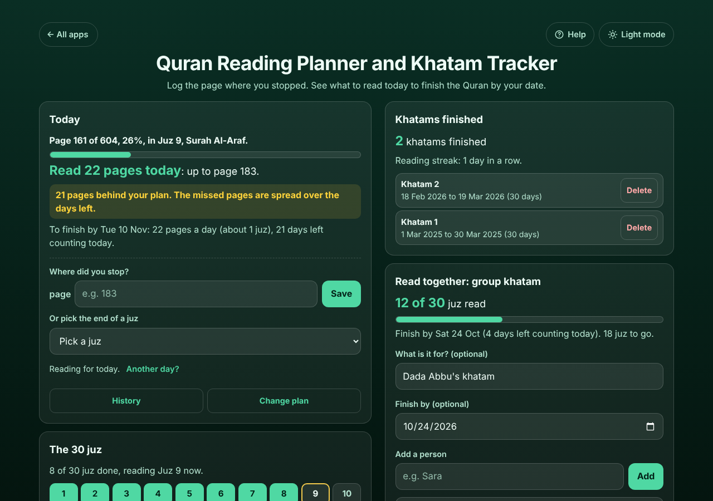

# Quran Reading Planner and Khatam Tracker

A free **Quran reading planner that tells you what to read today**. Pick a finish date (such as the last day of Ramadan) or a number of pages a day, type the page where you stopped, and it shows today's pages and the page to stop on, how far behind or ahead of your plan you are (missed pages are spread over the days left, so you never have to catch up in one day), the 30 juz you have finished and every khatam you complete. It works with the 604-page Madani copy, Indo-Pak copies (548, 610 or 848 pages) or any page count you type. A **group khatam** shares the 30 juz between family members for a gathering, Ramadan or someone who has passed away, with ticks and a list to paste in WhatsApp. No sign-up, no ads, private on your device, works offline.

**Live demo:** [umar8092.github.io/apps/quran-reading-planner-and-khatam-tracker](https://umar8092.github.io/apps/quran-reading-planner-and-khatam-tracker/)

| Desktop | On a phone |
|---|---|
|  |  |

## The situation it solves

Fatima wants to finish the Quran (Madani copy, **604 pages**) in 30 days, from **Mon 12 Oct to Tue 10 Nov 2026**. She sets the plan: *21 pages a day (about 1 juz): 604 pages in 30 days* (604 ÷ 30 = 20.13, rounded up). Each evening she types the page where she stopped. She was ill on Mon 19 Oct and read nothing. On Wed 21 Oct, at page 161, the app says:

- **Page 161 of 604, 26%, in Juz 9, Surah Al-Araf.**
- **Read 22 pages today: up to page 183.**
- *21 pages behind your plan. The missed pages are spread over the days left.* (By the end of yesterday the plan wanted page 182: 604 × 9 ÷ 30 = 181.2, rounded up. 182 − 161 = 21.)
- *To finish by Tue 10 Nov: 22 pages a day (about 1 juz), 21 days left counting today.* (443 pages left ÷ 21 days = 21.1, rounded up to 22.)
- *8 of 30 juz done, reading Juz 9 now.* (In the Madani copy juz 1 is pages 1 to 21 and every juz after that is 20 pages, so juz 8 ends on page 161.)

When she types 183 the box says *Today's reading is done* and gives the pages a day from tomorrow. If she forgot to log a day, **Another day?** fills it in. If she types a page lower than where she was, the app tells her instead of saving it.

When she reaches page 604: **Khatam complete, Mashallah! You read all 604 pages in 30 days.** **Save this khatam and start the next** keeps it under *Khatams finished* and sets up the next plan with the same number of days.

**The family khatam.** For Dada Abbu's khatam on Saturday, Fatima adds 7 names and taps **Share the juz out evenly**: 30 ÷ 7 is 4 with 2 left over, so Fatima and Ali read 5 juz and everyone else 4 (Fatima Juz 1-5, Ali 6-10, Ammi 11-14 ... Hina 27-30). Each person has their own box; she taps a juz when that person says it is done, and **Copy the list for WhatsApp** gives:

```
Khatam: Dada Abbu's khatam
Finish by 24 Oct 2026
12 of 30 juz read

Fatima: Juz 1 ✓, 2 ✓, 3 ✓, 4, 5
Ali: Juz 6 ✓, 7 ✓, 8, 9, 10
...
Still to read: Juz 4, 5, 8-10, 14, 16-18, 20-22, 25-30
```

## Features

- **Help button.** Tap **Help** at the top for a short how-to written for this app, and tap **All apps** to go back to the list.
- **Two kinds of plan:** **Finish by a date** (quick picks: in 30 days, in 2 months, in a year) or **Pages every day** (2 pages, 5 pages, half a juz, 1 juz, or any number), with a preview of the pages a day or the finish date before you start. Plans can start on a later day, such as the first day of Ramadan.
- **Your copy:** 604 pages (Madani, 15 lines a page), 610 (Indo-Pak, 15 lines), 548 (Indo-Pak, 16 lines), 848 (Indo-Pak, 13 lines) or any number of pages. Juz are exact in the Madani copy and marked "about" in others. Surah names are shown for the Madani copy.
- **Already part way?** Start from any page.
- **Today box:** the pages to read today and the page to stop on, behind or ahead of plan, the pages a day still needed, or for a fixed amount the day you finish at that pace and whether it is later or earlier than planned.
- **Log by page or pick the end of a juz.** **Another day?** fills in a day you forgot. Pages that go backwards or past the end are refused with a clear message.
- **History** of every day logged, with delete and **Undo**.
- **The 30 juz** as boxes: finished filled in, the one you are reading outlined.
- **Khatams finished** with their dates, and your **reading streak**.
- **Group khatam:** each person in their own box, share the juz out evenly, tap a juz when it is read, give any juz to someone else or leave it "Not taken", rename or remove people with **Undo**, an optional title and finish date, **Copy the list for WhatsApp**, **Start again with the same people**.
- **Copy my progress** and **Email my progress** (works with no address typed), **Save a backup file**, **Restore a backup**, **Delete everything** with Undo.
- **Private.** Your data is never sent anywhere; it stays in this browser on this device. The app counts pages only and gives no religious rulings.
- **Works offline and installable.** Phone friendly, with a two-column layout on laptops.
- **Back to all apps.** A "← All apps" button at the top of the page.
- **Light and dark mode switch.** It follows your device until you choose, and remembers your choice in every app.

## Run it yourself

No build step and no dependencies.

```bash
git clone https://github.com/umar8092/apps.git
```

Then open `quran-reading-planner-and-khatam-tracker/index.html` in your browser.

Offline mode and install need the files served over `https` or `localhost` (for example `python3 -m http.server`).

## How it works

- `core.js` is the logic, with no page code. Positions are whole page numbers. A date plan's target for day *n* of *N* is the pages × *n* ÷ *N*, rounded up; "behind" compares where you were at the end of yesterday with that target. Today's pages are the pages left (from this morning) divided by the days left counting today, rounded up, so missed pages are spread out. Madani juz start on page 1, 22, 42 ... 582; other copies are split into 30 even parts.
- `script.js` builds the page. Names and titles are added as plain text, never as HTML.
- `sw.js` saves the app on your device for offline use (network first, so you always get the newest version when online).
- Run the logic checks with `node tests.js` (or open `test.html`), and the full page test with `node ui-test.js` (needs Playwright).

## License

[MIT](LICENSE). Free to use, copy, modify and share. Made by [Muhammad Umar](https://github.com/umar8092).
