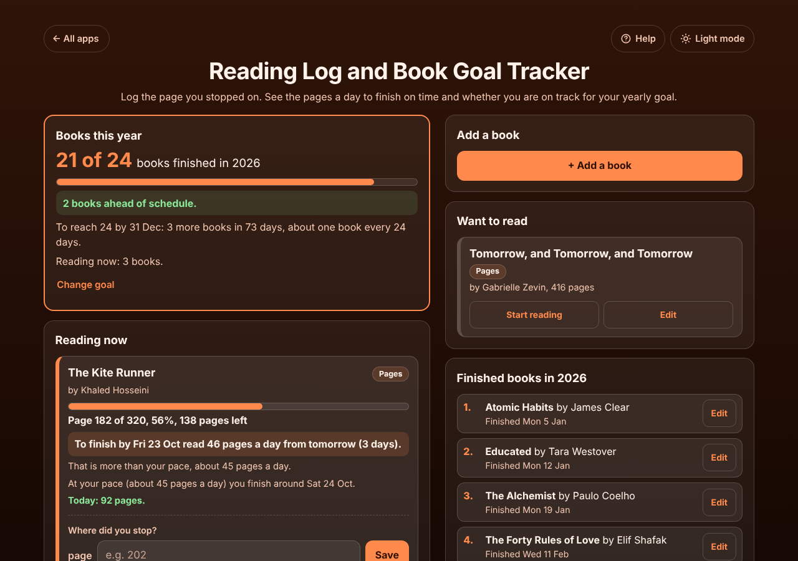

# Reading Log and Book Goal Tracker

A free **reading log that tells you how many pages a day to read**. Type the page you stopped on and it shows how many pages a day you need to finish a book by your date (book club, exam, library due date), when you will finish at your own pace, your reading streak, and whether you are on track for your yearly book goal. It works for paper books (pages), ebooks that show a percent (such as Kindle) and audiobooks (time listened or time left). No sign-up, no ads, private on your device, works offline.

**Live demo:** [umar8092.github.io/apps/reading-log-and-book-goal-tracker](https://umar8092.github.io/apps/reading-log-and-book-goal-tracker/)

| Desktop | On a phone |
|---|---|
|  |  |

## The situation it solves

Ayesha's book club meets on **Friday 23 October** to talk about *The Kite Runner* (320 pages). She adds the book with its pages and the finish-by date on Friday 16 October, then logs where she stops: page 40 on Saturday, page 90 on Sunday (she forgot that day, so she taps **Another day?**), and page 182 on Tuesday 20 October. The app answers in plain words:

- **Page 182 of 320, 56%, 138 pages left.**
- **To finish by Fri 23 Oct read 46 pages a day from tomorrow (3 days).** (138 ÷ 3 = 46. She has already read today, so the plan starts tomorrow.)
- *That is more than your pace, about 45 pages a day.* (182 pages from Saturday to Tuesday is 4 days, 45.5 a day, rounded down so it never promises too much.)
- *At your pace (about 45 pages a day) you finish around Sat 24 Oct.* So she reads a little more each day.

Before she logged anything on Tuesday, the same box said *read 58 pages a day from today (4 days)* (230 ÷ 4 = 57.5, rounded up).

Her yearly goal is **24 books**. She has finished 21 in 2026. On 20 October (day 293 of 365) the goal spread evenly asks for 24 × 293 ÷ 365 = 19.3, so about 19 by today:

- **21 of 24 books finished in 2026. 2 books ahead of schedule.**
- *To reach 24 by 31 Dec: 3 more books in 73 days, about one book every 24 days.*

If she types page 150 by mistake after page 182, the app asks *"Page 150 is before page 182, where you were last time. Did you go back to re-read?"* Going back counts nothing; a typing mistake is fixed with **No, let me fix it**, or deleted under **History**.

## Features

- **Help button.** Tap **Help** at the top for a short how-to written for this app, and tap **All apps** to go back to the list.
- **Each book in its own box** under *Reading now*, with its progress bar, pages left, pages a day to finish by your date and your finish date at your pace. Read several books at once.
- **Pages, percent or listening.** Paper books and ebooks by page, Kindle-style ebooks by percent, audiobooks by hours and minutes listened or **time left**, as Audible shows it.
- **Log another day** if you forgot, with checks so the pages always go forward (or you confirm you went back to re-read).
- **History** of every reading with what you read that day; delete a wrong entry with **Undo**.
- **Yearly book goal** (optional): ahead, on track or behind, and how often you need to finish a book. Books count for the year they were finished in, so a book finished on 31 December counts for that year. Pick past years under **Year**.
- **Reading days:** streak, longest streak, today, the last 7 and 30 days, and a 30-day bar chart.
- **Want to read** list, **Already finished** books (to count books read before you started using the app), **Stop reading** for books you put aside (they do not count) and **Read again**.
- **Copy my book list** and **Email my book list** (works with no address typed) share the books you finished in the year shown.
- **Edit and delete** with **Undo**, **Save a backup file** and **Restore a backup**, **Delete everything** with Undo.
- **Private.** Your data is never sent anywhere; it stays in this browser on this device.
- **Works offline and installable.** Phone friendly, with a two-column layout on laptops.
- **Back to all apps.** A "← All apps" button at the top of the page.
- **Light and dark mode switch.** It follows your device until you choose, and remembers your choice in every app.

## Run it yourself

No build step and no dependencies.

```bash
git clone https://github.com/umar8092/apps.git
```

Then open `reading-log-and-book-goal-tracker/index.html` in your browser.

Offline mode and install need the files served over `https` or `localhost` (for example `python3 -m http.server`).

## How it works

- `core.js` is the logic, with no page code. Positions are whole numbers (a page, a percent, or minutes). What you read each day is the sum of the steps forward, so going back counts nothing and re-read pages count again. Pages a day are the pages left divided by the days left, rounded up; your pace is what you read in the last 30 days divided by the calendar days.
- `script.js` builds the page. Titles and authors are added as plain text, never as HTML.
- `sw.js` saves the app on your device for offline use (network first, so you always get the newest version when online).
- Run the logic checks with `node tests.js` (or open `test.html`), and the full page test with `node ui-test.js` (needs Playwright).

## License

[MIT](LICENSE). Free to use, copy, modify and share. Made by [Muhammad Umar](https://github.com/umar8092).
