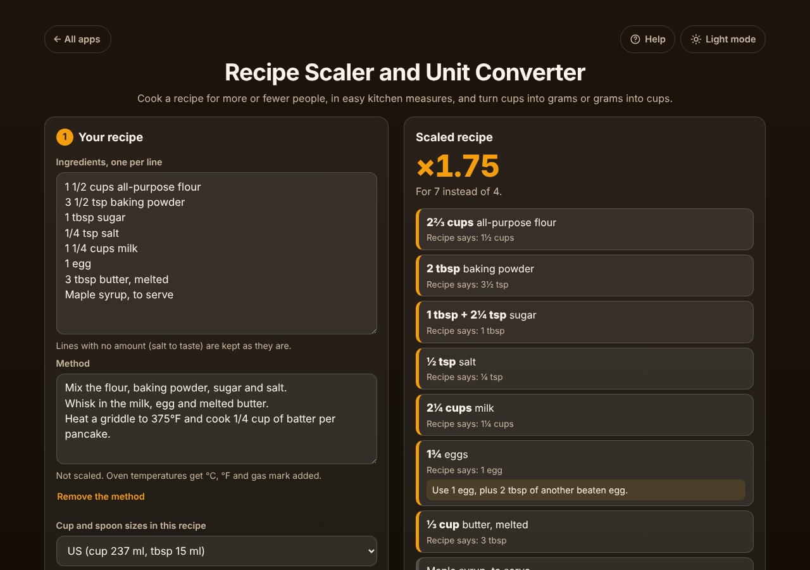

# Recipe Scaler and Unit Converter

A free **recipe scaler** for home cooks. Paste the ingredients from any recipe, type how many it makes and how many you want to make, and every amount is scaled and shown in **measures you can actually scoop**: 1⅓ cups, not 1.3125 cups, and "1 tbsp + 2¼ tsp", not 0.109 cups. Switch to **grams and ml** to turn cups into grams (or back to cups and spoons), get oven temperatures in °C, °F and gas mark, and find out what to do with ¾ of an egg. Save your recipes and scale them again next time. Private on your device: no account, no ads. Works offline.

**Live demo:** [umar8092.github.io/apps/recipe-scaler-and-unit-converter](https://umar8092.github.io/apps/recipe-scaler-and-unit-converter/)

| Desktop | On a phone |
|---|---|
|  |  |

## The situation it solves

Your pancake recipe serves 4, but 7 people are coming for breakfast. Multiplying 1¼ cups by 1.75 in your head gives 2.1875 cups, which no measuring cup has. Paste the recipe, type **The recipe makes 4** and **I want to make 7**, and the app says **×1.75**:

| The recipe says | Exactly ×1.75 | The app says |
|---|---|---|
| 1½ cups all-purpose flour | 2.625 cups | **2⅔ cups** (within 2%) |
| 3½ tsp baking powder | 6.125 tsp | **2 tbsp** |
| 1 tbsp sugar | 1¾ tbsp | **1 tbsp + 2¼ tsp** (exact) |
| ¼ tsp salt | 0.4375 tsp | **½ tsp** |
| 1¼ cups milk | 2.1875 cups | **2¼ cups** |
| 1 egg | 1.75 eggs | **1¾ eggs**: *Use 1 egg, plus 2 tbsp of another beaten egg.* |
| 3 tbsp butter, melted | 5¼ tbsp | **⅓ cup** |
| Maple syrup, to serve | | kept as written |

The method line "Heat a griddle to 375°F" becomes **375°F (190°C, 170°C fan, gas 5)**. Times are never changed, and a note reminds you a bigger batch may need a few more minutes.

Prefer a kitchen scale? Choose **Grams and ml**: flour becomes **≈ 315 g**, milk **520 ml**, butter **≈ 74 g**, while the baking powder stays **2 tbsp** (scales are not accurate for a few grams). Have a European recipe? **Cups and spoons** turns **500 g flour into ≈ 4¼ cups** and **250 ml milk into 1 cup + 1 tbsp**.

Only 2 of the 3 eggs a recipe needs? Tap **+ Scale to an ingredient I have**, pick "3 eggs" and type 2: **I want to make** changes from 4 to **2.67**, and everything else follows (×0.67).

Other cases it handles: halving (1 egg becomes ½ egg, "Beat 1 egg and use 1½ tbsp of it"), ⅛ tsp halved ("a pinch"), ranges (2-3 cloves garlic ×1.75 = 3½–5¼ cloves), two-part amounts (1 cup + 2 tbsp, 1 lb 4 oz), amounts at the end of the line (Butter 100g), "Juice of 1 lemon", "a dozen eggs", "half a cup", 1½ / 1 1/2 / 1-1/2 / 1.5 / 1,5, 200g written together, 1,000 g, bullets and tick boxes copied from recipe websites, headings like "For the sauce:", numbered steps and "20 minutes" or "9-inch" (not scaled), the same amount written twice "1 cup (2 sticks) butter", Australian 20 ml tablespoons and 250 ml cups, °C fan ovens and gas marks. Servings of 0, negative, words or over 10,000, and more than 1,000 times the recipe, are refused with a plain message. Corrupt saved data starts fresh, and if the browser blocks storage the app still works and says it is not saving.

## Features

- **Help button.** Tap **Help** at the top for a short how-to, and **All apps** to go back to the list of apps. **Light mode / Dark mode** switch.
- **Paste or type the ingredients**, one per line. The result updates as you type, each ingredient in its own box with **"Recipe says: …"** underneath so you can check it.
- **The recipe makes / I want to make**, with **Half**, **Same**, **Double** and **Triple** buttons. Works with servings, people, cookies or tins.
- **+ Scale to an ingredient I have (optional)**: pick an ingredient, type how much you have, and the whole recipe follows.
- **Show amounts in:** **As written**, **Grams and ml** (typical weights for common ingredients such as flour, sugars, butter, oats, rice, honey and cocoa, marked ≈; liquids in ml) or **Cups and spoons** (US).
- **Cup and spoon sizes in this recipe:** US (237 ml cup), UK / Canada / metric (250 ml cup) or Australia (20 ml tablespoon).
- **Easy kitchen measures:** cups in ¼ and ⅓ steps, tablespoons and teaspoons down to ⅛, split into two measures when one is not close enough.
- **Eggs:** what to do with part of an egg.
- **+ Add the method (optional):** oven temperatures get °C, °F, fan and gas mark added.
- **Copy**, **Email** (opens your mail app with the scaled recipe, no address needed) and **Print** (only the recipe).
- **My recipes:** save with a name, open next time, update by saving with the same name, **Delete** with **Undo**. **Start a new recipe** with Undo.
- **Try an example recipe** to see how it works.
- **Private, works offline and installable.** Phone and desktop layouts. Works with a keyboard and a screen reader.

## Run it yourself

No build step and no dependencies.

```bash
git clone https://github.com/umar8092/apps.git
```

Then open `recipe-scaler-and-unit-converter/index.html` in your browser. Offline mode and install need the files served over `https` or `localhost` (for example `python3 -m http.server`).

## How it works

- `core.js` is the maths, with no page code. Every amount is read into an exact fraction (1 1/2 = 3/2) and multiplied by the exact ratio of the two numbers (7/4), so nothing drifts. Only when it is shown is it turned into ml or grams and rounded to the nearest friendly measure: one measure if it is within about 3% (5% when turned between weight and volume), otherwise a cup measure plus spoons. Cup weights are typical values per US cup (all-purpose flour 120 g, sugar 198 g, brown sugar 213 g, butter 227 g).
- `script.js` builds the page. Everything you type is added as plain text, never as HTML. The current recipe is saved in this browser under `recipe-scaler-and-unit-converter.state` and your saved recipes under `recipe-scaler-and-unit-converter.recipes`.
- `sw.js` saves the app for offline use (network first, so updates always arrive).
- Checks: `node tests.js` for the maths (also `test.html` in a browser), `node ui-test.js` drives the real page in headless Chromium (add `--base https://umar8092.github.io/apps` to test the live site).

## License

[MIT](LICENSE). Free to use, copy, modify and share. Made by [Muhammad Umar](https://github.com/umar8092).
