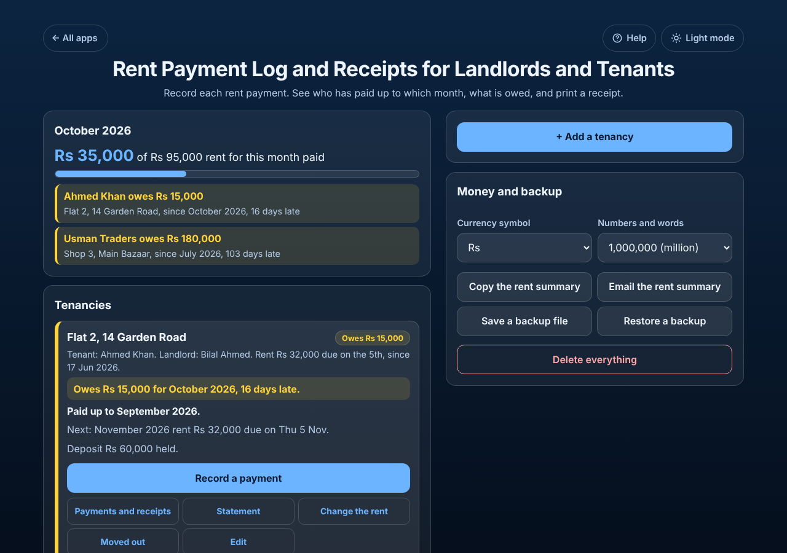

# Rent Payment Log and Receipts for Landlords and Tenants

A free **rent payment log that tells you who has paid up to which month and what is owed**. Add each tenancy (a flat, a room, a shop) with the rent, the day it is due and the move-in day, then record each payment as it comes in, full, part, late or in advance. The app answers "Owes 15,000 for October 2026, 16 days late" and "Paid up to September 2026", adds up this month's rent for every tenancy, and makes a **printable rent receipt** with the amount in words and the rent still owed, plus a **yearly rent statement**. Rent rises, part months when someone moves in or out mid-month, and deposits are handled. Tenants can use it too, to keep proof of the rent they paid. No sign-up, no ads, private on your device, works offline.

**Live demo:** [umar8092.github.io/apps/rent-payment-log-and-receipts-for-landlords-and-tenants](https://umar8092.github.io/apps/rent-payment-log-and-receipts-for-landlords-and-tenants/)

| Desktop | On a phone |
|---|---|
|  |  |

## The situation it solves

Bilal rents **Flat 2, 14 Garden Road** to Ahmed Khan from **17 June 2026** at **30,000 a month, due on the 5th**, with a 60,000 deposit. Ahmed moved in mid-month, so Bilal ticks *Charge the first month only for the days lived*: June is 14 of 30 days, **14,000**, due on the move-in day. From October the rent goes up to **32,000** (*Change the rent*, from October 2026).

Ahmed pays 14,000 on 17 Jun, 30,000 on 4 Jul, 30,000 on 6 Aug, 20,000 on 10 Sep, 10,000 on 25 Sep and 17,000 on 8 Oct. On **21 October** the box says:

- **Owes 15,000 for October 2026, 16 days late.** (Rent due so far: 14,000 + 3 × 30,000 + 32,000 = 136,000. Paid: 121,000. October was due on the 5th, 16 days ago.)
- **Paid up to September 2026.** (Payments pay the oldest rent first: the 20,000 and 10,000 in September together cover September.)
- *Next: November 2026 rent 32,000 due on Thu 5 Nov.*
- *Deposit 60,000 held.*

**Receipt 6** for the 8 October payment reads: *Received from Ahmed Khan the sum of 17,000 (Seventeen thousand only) by bank transfer, for part of the rent for October 2026 (17,000 of 32,000), at Flat 2, 14 Garden Road. Rent still owed after this payment: 15,000. Received by: Bilal Ahmed.* It prints on its own page (or saves as PDF) and can be copied for WhatsApp.

The **2026 statement** lists June to October with each month's rent, what was paid towards it and what is owed, the six payments received, and the totals: rent 136,000, paid 121,000, owed 15,000.

If Ahmed pays 47,000 today, the box says *Paid up to November 2026* and *32,000 paid ahead*, and the receipt says it paid *the rest of the rent for October 2026 (15,000 of 32,000), rent for November 2026*.

## Features

- **Help button.** Tap **Help** at the top for a short how-to written for this app, and tap **All apps** to go back to the list.
- **Each tenancy in its own box** with paid up to, owed and days late, the next rent and the deposit.
- **This month:** the rent due this month for all tenancies, what has been paid, and who still owes and since when.
- **Record a payment** with the date, amount, how it was paid (cash, bank transfer, mobile wallet, cheque, card, other) and an optional note. **Fill in what is owed** in one tap. Part payments and payments in advance are fine; payments always pay the oldest rent first.
- **Payments and receipts:** every payment with the months it paid for; **Receipt**, **Edit** and **Delete** with **Undo**. Receipts are numbered per tenancy.
- **Rent receipt** with the amount in figures and words, both names, the property, the months covered and the rent still owed (or paid ahead) after it. **Print or save as PDF** or **Copy text**.
- **Statement** for any year, printable or copied.
- **Change the rent** from a month; earlier months keep the old rent.
- **Moved in or out mid-month:** a full month, or only the days lived. Due day 29, 30 or 31 falls on the last day of shorter months.
- **Move-out and deposit:** the last day, money paid beyond the rent, and how much of the deposit was returned. Moved-out tenancies fold away.
- **Currency symbol** (none, $, €, £, ₹, Rs, PKR, AED, SAR and more) and **1,000,000 (million)** or **10,00,000 (lakh)** numbers and words, remembered.
- **Copy the rent summary** and **Email the rent summary** (works with no address typed), **Save a backup file**, **Restore a backup**, **Delete everything** with Undo.
- **Private.** Your data is never sent anywhere; it stays in this browser on this device.
- **Works offline and installable.** Phone friendly, with a two-column layout on laptops.
- **Back to all apps.** A "← All apps" button at the top of the page.
- **Light and dark mode switch.** It follows your device until you choose, and remembers your choice in every app.

## Run it yourself

No build step and no dependencies.

```bash
git clone https://github.com/umar8092/apps.git
```

Then open `rent-payment-log-and-receipts-for-landlords-and-tenants/index.html` in your browser.

Offline mode and install need the files served over `https` or `localhost` (for example `python3 -m http.server`).

## How it works

- `core.js` is the logic, with no page code. Money is kept in whole cents, so there are no rounding errors. Rent is charged per calendar month and is due on the due day; a part month is the rent × days lived ÷ days in the month, rounded to a whole amount. All payments are added up and paid against the months in order, oldest first, which gives "paid up to", "owed" and "paid ahead"; the same walk tells each receipt which months its payment covered.
- `script.js` builds the page. Names, places and notes are added as plain text, never as HTML.
- `sw.js` saves the app on your device for offline use (network first, so you always get the newest version when online).
- Run the logic checks with `node tests.js` (or open `test.html`), and the full page test with `node ui-test.js` (needs Playwright).

## License

[MIT](LICENSE). Free to use, copy, modify and share. Made by [Muhammad Umar](https://github.com/umar8092).
