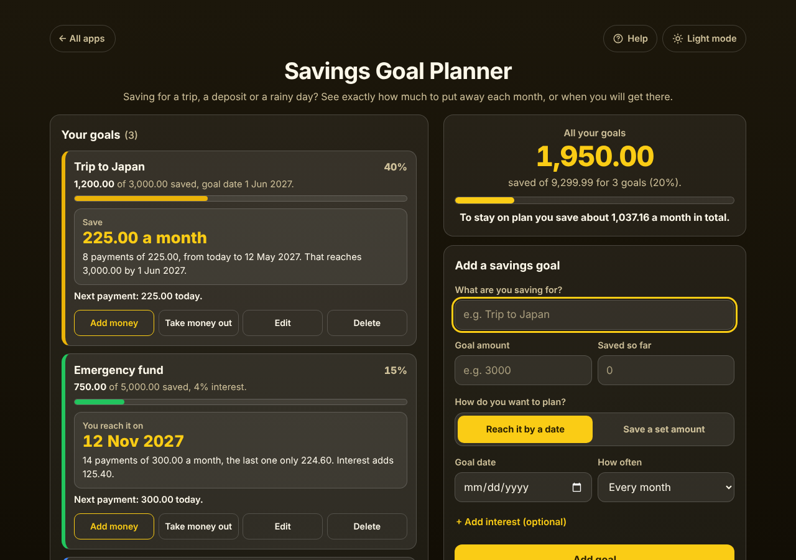

# Savings Goal Planner

A free **savings goal planner** for anyone putting money aside for a trip, a house deposit, a new laptop or an emergency fund. Add the goal, what you have saved and either the date you need it by or how much you can save each time. The app tells you **exactly how much to save every month, every 2 weeks or every week**, or **the date you will reach it**, counting each payment to the cent (the last one is a little smaller when it does not divide evenly). Each goal has its own settings and its own box, and as you **add money or take money out** the plan works itself out again from today. Optional interest from a savings account. Private on your device: no account, no bank connection, no ads. Works offline.

**Live demo:** [umar8092.github.io/apps/savings-goal-planner](https://umar8092.github.io/apps/savings-goal-planner/)

| Desktop | On a phone |
|---|---|
|  |  |

## The situation it solves

It is Monday 12 October 2026 and you are saving for three things:

1. **Trip to Japan**: 3,000.00, you have 1,200.00, and you fly on 1 June 2027. You save once a month.
   **Save 225.00 a month.** 8 payments of 225.00, from today to 12 May 2027 (12 Oct, 12 Nov, ... 12 May; 12 Jun is too late). 8 × 225.00 = 1,800.00, exactly what is missing.
2. **Emergency fund**: 5,000.00, you have 750.00, you can save 300.00 a month in an account paying 4% a year.
   **You reach it on 12 Nov 2027.** 14 payments of 300.00 a month, the last one only 224.60. Interest adds 125.40 (750.00 + 13 × 300.00 + 224.60 + 125.40 = 5,000.00).
3. **New laptop**: 1,299.99, nothing saved yet, wanted by 24 December 2026, saving every week.
   **Save 118.19 a week.** 11 payments of 118.19, the last one only 118.09, from today to 21 Dec 2026 (10 × 118.19 + 118.09 = 1,299.99).

At the top: **1,950.00 saved of 9,299.99 for 3 goals (20%). To stay on plan you save about 1,037.16 a month in total** (225.00 + 300.00 + 118.19 × 52 ÷ 12).

Then life happens:

- You put 225.00 into the Japan fund today: tap **Add money**. The goal now says **Next payment: 225.00 on 12 Nov 2026. You already saved this month**, with 7 payments left, so the plan never asks you to pay twice in one month.
- The car needs a repair and you take 200.00 out: tap **Take money out**. With 1,000.00 saved the plan becomes **Save 250.00 a month** (2,000.00 ÷ 8).
- You save more than the goal: **Goal reached. You have 200.00 more than you need.**
- The goal date passes before you get there: **Still needed: 600.00. The goal date, 30 Sep 2026, has passed. Tap Edit to pick a later date, or switch to Save a set amount.**

Other cases it handles: odd amounts (1,801.00 over 8 months is 225.13 each and a last one of 225.09), a goal one day away (one payment of everything today), money already put in this period with a goal date before the next payment (it says to put the rest in before then), a set amount so small it would take more than 100 years, interest alone reaching the goal, 31 January + 1 month = 28 February, taking out more than is saved (refused), a future date for money in (refused), a goal amount of 0, blank or negative amounts, words, huge numbers, a goal date today or in the past, interest over 30% (each refused with a plain message), amounts typed or pasted as `3,000`, `12,50` or `1.299,50 €`, very long names (cut to 50 characters and wrapped). The plans are worked out again at midnight if the app is open. Corrupt saved data is cleaned up, and if the browser blocks storage the app still works and says it is not saving.

## Features

- **Help button.** Tap **Help** at the top for a short how-to, and **All apps** to go back to the list of apps. **Light mode / Dark mode** switch.
- **Two ways to plan each goal:** **Reach it by a date** (how much each time) or **Save a set amount** (when you get there).
- **How often you save**, per goal: every month, every 2 weeks (each payday) or every week.
- **Exact payments:** how many, from when to when, and the smaller last payment when it does not divide evenly.
- **Next payment** with the amount and the date.
- **Add money** and **Take money out** for each goal, with the date; **Money in and out** lists every change, with Delete and Undo.
- **+ Add interest (optional)** at the yearly rate of your savings account.
- **All your goals** at the top: total saved, progress bar and about how much you save a month in total.
- **Edit** a goal (Escape cancels), **Delete** with **Undo** in place, **Delete all goals** with Undo.
- **Currency symbol** (none, $, €, £, ₹, Rs, ¥, ₩, ₦, ₱, R, kr, CHF, AED, SAR, RM), remembered. Plain numbers by default.
- **Copy plan**, **Email plan** (opens your mail app with every goal and what to save, no address needed) and **Print**.
- **Try three example goals** to see how it works before typing anything.
- **Private, works offline and installable.** Phone and desktop layouts. Works with a keyboard (Enter saves, Escape cancels) and a screen reader.

## Run it yourself

No build step and no dependencies.

```bash
git clone https://github.com/umar8092/apps.git
```

Then open `savings-goal-planner/index.html` in your browser. Offline mode and install need the files served over `https` or `localhost` (for example `python3 -m http.server`).

## How it works

- `core.js` is the maths, with no page code. Money is whole cents and dates are calendar dates, so time zones never move a payment. Payments fall on the same day each month (or every 14 or 7 days) starting today, or one period after money you already put in this period. By a date: the smallest whole-cent amount whose payments reach the goal by that date (found by a binary search over a payment-by-payment run). A set amount: the payments are run one by one until the goal is reached, up to 100 years. Interest is the yearly rate divided by the payments a year, added before each payment and rounded to the cent.
- `script.js` builds the page. Everything you type is added as plain text, never as HTML. Your goals are saved in this browser's storage under `savings-goal-planner.state`, and every saved value is checked before it is used.
- `sw.js` saves the app for offline use (network first, so updates always arrive).
- Checks: `node tests.js` for the maths (also `test.html` in a browser), `node ui-test.js` drives the real page in headless Chromium with the clock fixed at 12 October 2026 (add `--base https://umar8092.github.io/apps` to test the live site).

## License

[MIT](LICENSE). Free to use, copy, modify and share. Made by [Muhammad Umar](https://github.com/umar8092).
