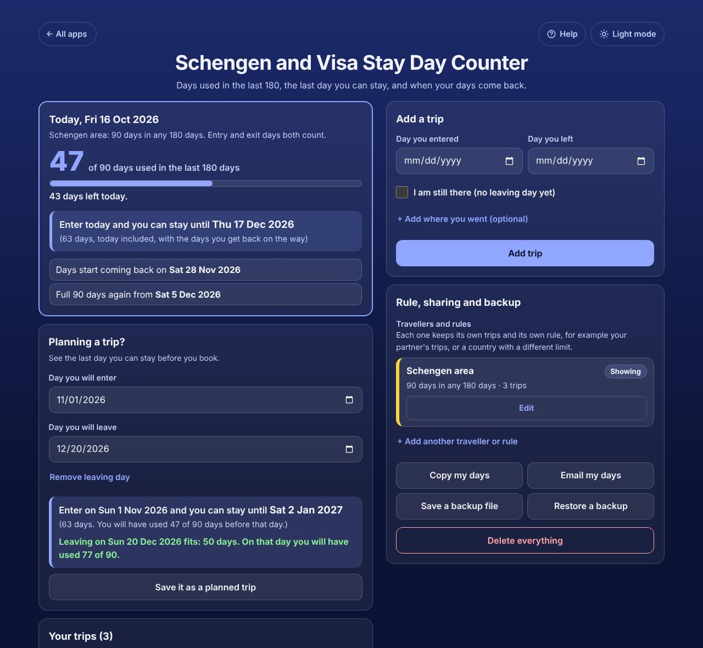

# Schengen and Visa Stay Day Counter

A free **Schengen 90/180 day calculator** for anyone travelling on a short-stay visa or visa-free. Add each trip with the day you entered and the day you left, and the app shows **how many of your 90 days you have used in the last 180**, **the last day you can stay** if you enter today or on any day you choose, **when your days start coming back**, and **when you can stay a full 90 days again**. It checks every single day of a stay, so it counts the days you get back on the way. Other rules work too (180 or 183 days in any 365, or your own). Works offline, no sign-up, no ads.

**Live demo:** [umar8092.github.io/apps/schengen-and-visa-stay-day-counter](https://umar8092.github.io/apps/schengen-and-visa-stay-day-counter/)

| Desktop | On a phone |
|---|---|
|  |  |

## The situation it solves

Ayesha lives in Lahore and has a multiple-entry Schengen visa. This year she was in Spain from 1 March to 15 April, in Paris and Rome from 1 to 20 June, and in Berlin and Prague from 10 August to 5 September. On Friday 16 October 2026 she wants to book another trip and must not overstay: since the EU Entry/Exit System started, every entry and exit is recorded and an overstay can mean a ban.

The app answers:

- **47 of 90 days used** in the last 180 days (20 in June and 27 in August and September; the Spain trip is older than 180 days and no longer counts), **43 days left today**.
- **Enter today and you can stay until Thu 17 Dec 2026** (63 days, not 43, because the June days drop out of the window while she is there).
- **Days start coming back on Sat 28 Nov 2026**, and **full 90 days again from Sat 5 Dec 2026**.
- **Planning a trip:** entering on Sun 1 Nov 2026 she can stay until **Sat 2 Jan 2027**. Leaving on 20 Dec **fits**: 50 days, and on that day she will have used 77 of 90. Leaving on 20 Jan would be **too long**: she would be over 90 days on 3 Jan 2027.

If she is already there (entered 1 Oct, no leaving day yet), the app says **Last day you can stay: Thu 12 Nov 2026**, and saves that day to her calendar with reminders.

How the days are counted: on every day you are inside, the 180 days that end on that day may hold at most 90 days inside. The day you enter and the day you leave both count, a same-day trip counts as 1 day, and overlapping trips are counted once.

## Features

- **Help button.** Tap **Help** at the top for a short how-to written for this app, and tap **All apps** to go back to the list.
- **Today box:** days used out of 90, days left today, the real last day you can stay if you enter today, the day your days start coming back and when a full 90 days is possible again.
- **I am still there:** a trip with no leaving day shows the last day you can stay, or how long you have been over, with **Add the last day to my calendar** (reminders 7 days and 1 day before).
- **Planning a trip?** Choose the day you will enter to see the last day you can stay; add the day you will leave to see whether it fits or the day to leave by. Save it as a planned trip, and it is counted in every answer.
- **Each trip in its own box**, newest first: how many of its days still count and the day they stop counting, Planned or There now, red when the rule is broken. **Edit** and **Delete** with **Undo**.
- **Travellers and rules:** keep a separate count for a partner or child, or for another rule (180 or 183 days in any 365, 90 in 365, or any other).
- **Copy my days** and **Email my days** (email works without typing an address first).
- **Save a backup file** and **Restore a backup**, **Delete everything** with Undo. Damaged or blocked saved data is handled with a clear message.
- **Private.** Your trips stay in this browser on this device; your data is never sent anywhere.
- **Works offline and installable**, handy at a border with no signal. The count moves on by itself every day.
- **Back to all apps.** A "← All apps" button at the top of the page.
- **Light and dark mode switch.** It follows your device until you choose, and remembers your choice in every app.

Not legal advice: your visa may allow fewer days, and the border officer's count is the one that matters.

## Run it yourself

No build step and no dependencies.

```bash
git clone https://github.com/umar8092/apps.git
```

Then open `schengen-and-visa-stay-day-counter/index.html` in your browser.

Offline mode and install work best with the files served over `https` or `localhost` (for example `python3 -m http.server`).

## How it works

- `core.js` is the logic, with no page code. Dates are calendar dates (`2026-10-16`) turned into whole day numbers, so time zones and summer time never move a day. A stay is grown one day at a time, and each new day re-checks every window it falls in, including those of later planned trips, so the last day is exact and never a rough guess.
- `script.js` builds the page. Trip notes and names are added as plain text, never as HTML. Everything is saved in `localStorage`.
- `sw.js` saves the app on your device for offline use (network first, so updates show at once).
- Run the logic checks with `node tests.js` (or open `test.html`), and the full page test with `node ui-test.js` (needs Playwright). The tests fix "today" to 16 Oct 2026 and check the exact answers above.

## License

[MIT](LICENSE). Free to use, copy, modify and share. Made by [Muhammad Umar](https://github.com/umar8092).
