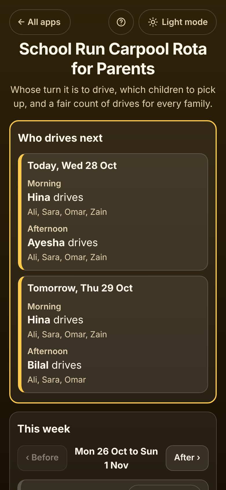

# School Run Carpool Rota for Parents

A free **school run carpool rota** for three to six families who take turns driving the children to school (or to football, madrassa or swimming) and keep asking "whose turn is it tomorrow?". Add each family in its own box with **their children, the seats in their car and the mornings or afternoons they cannot drive**, and the app answers **who drives today and tomorrow, which children to pick up**, and keeps a **fair count of drives** for every family. Swaps, a child off sick, holidays, a family away, a family joining after half term and optional **fuel cost sharing** ("Ayesha pays Bilal 275.00") are all handled. Copy the week for the parents' group chat. Private on your device: no account, no ads. Works offline.

**Live demo:** [umar8092.github.io/apps/school-run-carpool-rota-for-parents](https://umar8092.github.io/apps/school-run-carpool-rota-for-parents/)

| Desktop | On a phone |
| --- | --- |
|  |  |

## The situation it solves

Three families share the school run from Monday 26 October 2026, mornings to school and afternoons home:

- **Ayesha**, children Ali and Sara, 4 seats
- **Bilal**, child Omar, 4 seats
- **Hina**, child Zain, 4 seats, **cannot drive on Tuesdays** (she works that day)

On Thursday Zain has an after-school club, so he does not need the afternoon ride. Friday 30 October is a teacher training day.

You open the app on Wednesday morning and it says, without anyone working it out:

- **Today, Wed 28 Oct: Morning, Hina drives (Ali, Sara, Omar, Zain). Afternoon, Ayesha drives.**
- **Tomorrow, Thu 29 Oct: Morning, Hina drives. Afternoon, Bilal drives (Ali, Sara, Omar).**

The whole week, as "Copy this week" puts it in the group chat:

```
School run rota, week of Mon 26 Oct

Mon 26 Oct
  Morning: Ayesha drives (Ali, Sara, Omar, Zain)
  Afternoon: Bilal drives (Ali, Sara, Omar, Zain)
Tue 27 Oct
  Morning: Ayesha drives (Ali, Sara, Omar, Zain)
  Afternoon: Bilal drives (Ali, Sara, Omar, Zain)
Wed 28 Oct (today)
  Morning: Hina drives (Ali, Sara, Omar, Zain)
  Afternoon: Ayesha drives (Ali, Sara, Omar, Zain)
Thu 29 Oct
  Morning: Hina drives (Ali, Sara, Omar, Zain)
  Afternoon: Bilal drives (Ali, Sara, Omar)
Fri 30 Oct
  No school: Teacher training day
```

Why: each ride goes to the family with the fewest drives so far that can drive then. Hina could not drive on Tuesday, so on Wednesday she catches up in the morning, and the afternoon goes to Ayesha rather than to Hina again (a family that already drove that day only drives again when nobody else is close). **Drives so far** on Wednesday (up to and including today): **Ayesha 3, Bilal 2 (1 behind), Hina 1 (2 behind)**.

**Fuel cost sharing** (optional), at 300.00 a drive: the week's 8 drives cost 2,400.00. Each drive is paid back by the families of the children in the car, per child: with all four children, Ayesha's two children cost her 150.00 and Bilal and Hina 75.00 each; on Thursday afternoon (three children) Ayesha pays 200.00 and Bilal 100.00. Ayesha drove 3 times (900.00) and her children's share is 1,250.00; Bilal drove 3 (900.00) for a share of 625.00; Hina drove 2 (600.00) for a share of 525.00. So the app says **Ayesha pays Bilal 275.00 and Ayesha pays Hina 75.00**. After that every family has paid the same for each ride of each child.

Other cases it handles:

- **A swap.** "Change driver" on a ride lets Bilal take Hina's Thursday morning. The ride is marked Swapped and the rota gives Bilal fewer drives in the next days, so it evens out. "Back to the rota" undoes it.
- **A child off sick.** "Who is riding" unticks that child for one ride. If no child rides, it says "No ride needed" and nobody is counted.
- **No school.** One day with "Mark no school", or holidays and half term in "No school days".
- **A family away** (holiday, car in the garage): "Away dates" in their box. They do not drive and their children do not ride on those days.
- **Not enough seats.** The rota picks a car with enough seats for the children riding. If none has, it still picks a driver and shows "Too many children for Ayesha's car: 5 riding, 4 seats".
- **Nobody can drive** (everyone marked "cannot drive" for that time): the ride says so in red, and "Change driver" lets you pick someone.
- **A child who only rides one way:** "Mornings only" or "Afternoons only" next to their name.
- **A family joining mid-term** starts level with the family that has driven least, so they do not drive every day to catch up. A family that leaves is taken off from today; their past drives stay in the count.
- **Changing your mind later.** Days that have passed are kept as they were, so changing a family's days or seats never rewrites past drives (you can still correct a past day in the week).
- **Mornings only, or only some days.** Choose the school days (any of Mon to Sun) and whether there is a morning ride, an afternoon ride or both.
- Blank, duplicate or very long names, a child typed twice, a holiday that ends before it starts, a cost of `-5` or `ten` (each refused with a plain message), costs typed as `300`, `4.50`, `12,50` or `1,20,000`, damaged saved data or backups (cleaned up or refused), and storage blocked by the browser (it still works and says it is not saving). Money is kept in whole cents and dates as calendar dates, so totals are exact and time zones never move a drive.

## Features

- **Who drives next:** today and the next school day, who drives each ride and which children to pick up.
- **The week**, each school day in its own box: driver, children, "3 of 4 seats", swaps, warnings. Before and After to move between weeks.
- **Change driver**, **Who is riding** and **Mark no school** on any ride or day, each with Undo.
- **Families**, each in its own box: children (each riding both ways, mornings only or afternoons only), seats, the times they cannot drive, away dates. Edit and Remove with Undo.
- **Drives so far:** each family's drives up to today and how far behind the family that drove most.
- **Fuel cost sharing (optional):** cost of one drive, a remembered currency symbol (none, $, €, £, ₹, Rs, AED and more), month by month: what each family is owed, its share and the fewest payments that settle it. "Copy who pays who".
- **Copy, Share or Email this week** for the parents' group chat (email works without typing an address), and **Print this week**.
- **Settings:** name of the run (School run, Football practice...), school days, morning and afternoon rides, no school days, start counting again, backup and restore, delete everything (with Undo).
- **Help button** in the top bar with a step-by-step guide, an **All apps** back button, and a **light/dark switch** (it follows your device until you choose).
- Works on phones and laptops (on a wide screen the rota is on the left and families and costs on the right), installable, and **works offline**. Your data is never sent anywhere.

## Run it yourself

```
git clone https://github.com/umar8092/apps.git
```

Then open `school-run-carpool-rota-for-parents/index.html` in your browser. Offline mode and install need the files served over `https` or `localhost` (for example `python3 -m http.server`).

## How it works

- `core.js` is the logic, with no page code. It walks every school day from the day the rota started. For each ride it takes the families who are in the carpool that day, not away and not marked "cannot drive", and picks the one with enough seats and the fewest drives so far (today's drive counts one extra, so one family rarely does both rides), then whoever drove longest ago, then the order the families were added. Swaps override the choice and are counted, so later days even out. Days before today are saved as they happened, so later changes never rewrite them. Fuel costs are shared per child in the car in whole cents, the odd cents going to the largest remainders, and the payments are settled with the fewest transfers.
- `script.js` builds the page. Everything you type is added as plain text, never as HTML. Your data is saved in this browser's storage under `school-run-carpool-rota-for-parents.state`, and every saved or restored value is checked before it is used.
- `sw.js` keeps a copy of the app for offline use. It is network-first: online you always get the newest version.
- `tests.js` (run `node tests.js` or open `test.html`) checks the rota and the money against hand-worked examples; `ui-test.js` drives the real page in a headless browser at 11 screen widths.

## License

MIT, see [LICENSE](LICENSE).
