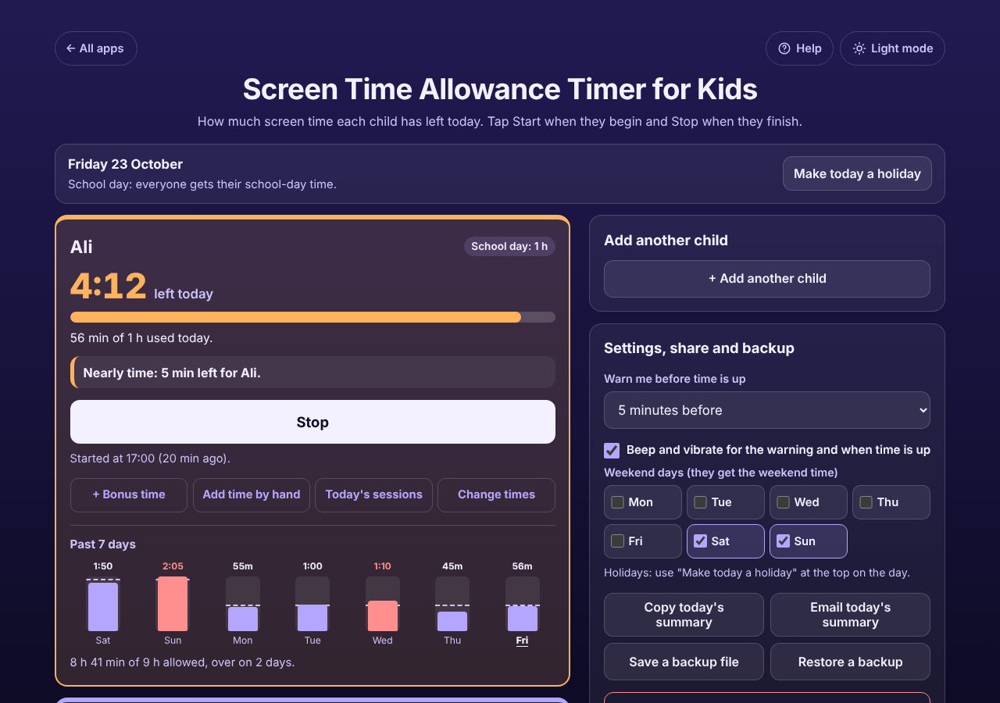

# Screen Time Allowance Timer for Kids

A free **screen time timer for parents**. Each child gets their own box with their own daily screen time for **school days** and for **weekends and holidays**. Tap **Start** when they pick up the tablet, TV, phone or games console and **Stop** when they hand it back, and see at a glance **how many minutes each child has left today**. It warns you before time runs out, says "Time is up" and how far over, takes bonus minutes for chores or homework, and shows the past 7 days. The time keeps counting when your phone is locked or the page is closed. Works offline, no sign-up, no ads, nothing to install on the child's device.

**Live demo:** [umar8092.github.io/apps/screen-time-allowance-timer-for-kids](https://umar8092.github.io/apps/screen-time-allowance-timer-for-kids/)

| Desktop | On a phone |
|---|---|
|  |  |

## The situation it solves

Every evening the same argument: "I only had 20 minutes!". A parent allows Ali (9) **1 hour on school days and 2 hours at weekends**, Sara (12) **1 h 30 min and 3 h**, and little Hamza (5) **no screen time on school days** and 30 minutes at weekends. Nobody remembers who has used how much, and the tablet, the TV and the games console are all different screens.

The parent adds the three children, each with their own times. On Friday 23 October:

- Ali starts at 17:00. The parent taps **Start** in his box. At 17:35 he hands the tablet back and the parent taps **Stop**: **"Ali: 25 min left today (35 min of 1 h used)."**
- At 19:00 he starts again. At 19:20 the box turns orange and beeps: **"Nearly time: 5 min left for Ali."** At 19:25 it turns red and beeps three times: **"Time is up for Ali."** If he carries on until 19:37 it says **"Time is up, over by 12 min"**.
- Sara finished her homework early, so she gets **+ Bonus time** of 15 minutes: her day becomes 1 h 45 min. After watching from 17:35 to 17:46 she has **"1 h 34 min left today (11 min of 1 h 45 min used, includes 15 min bonus)"**.
- Hamza's box simply says **"No screen time today"**. He watched 45 minutes at a cousin's house yesterday, so the parent uses **Add time by hand** for yesterday and his week shows it in red.
- Sara starts a film at 23:30 on Friday and stops at 00:30: 30 minutes count for Friday and 30 for Saturday, when she has her weekend 3 h.
- A school holiday on a Wednesday? **Make today a holiday** gives everyone their weekend time for that day.

## Features

- **Help button.** Tap **Help** at the top for a short how-to written for this app, and tap **All apps** to go back to the list.
- **Each child in their own box** with their own school-day and weekend time: presets (30 min, 1 h, 1 h 30 min, 2 h, 3 h, no screen time) or **Custom** (such as 45 or 1:15, up to 24 h).
- **Start and Stop** with a big countdown ("24:59 left today") while running, and "25 min left today" when stopped. Several children can run at once.
- **Warning before time is up** (1, 2, 5, 10 or 15 minutes, or none) and **Time is up**, with a beep and vibration (can be turned off), a coloured box and the tab title "Time is up: Ali". "Over by 12 min" if they keep going.
- **Keeps counting when the phone is locked or the page is closed**, because the start time is saved. A forgotten session is never counted as more than a day, and the box asks "Forgot to stop?" after 3 hours.
- **+ Bonus time** for today only, with an optional reason. **Add time by hand** for time you did not time, for today or the past week.
- **Today's sessions** for any of the past 7 days: **Edit** a session's start or end (an end before the start means after midnight), delete it, or delete a bonus. Overlapping sessions and times in the future are refused.
- **School days, weekends and holidays:** choose your weekend days (Saturday and Sunday, Friday and Saturday, or any), and tap **Make today a holiday** or **Make today a school day** for a one-off day.
- **Midnight handled:** each day starts fresh, and a session over midnight counts on both days.
- **Past 7 days** for each child: minutes used against the limit, days over in red, and the week's total.
- **Copy** or **Email today's summary** for the other parent or a babysitter (email works with no address typed).
- **Undo** on every change, **backup file and restore**, **Delete everything** with Undo. Damaged or blocked saved data is handled with a clear message.
- **Private.** Names and times stay in this browser on this device; your data is never sent anywhere.
- **Works offline and installable.**
- **Back to all apps.** A "← All apps" button at the top of the page.
- **Light and dark mode switch.** It follows your device until you choose, and remembers your choice in every app.

## Run it yourself

No build step and no dependencies.

```bash
git clone https://github.com/umar8092/apps.git
```

Then open `screen-time-allowance-timer-for-kids/index.html` in your browser.

Offline mode and install need the files served over `https` or `localhost` (for example `python3 -m http.server`).

## How it works

- `core.js` is the logic, with no page code. A session is saved as its real start and end time, so the time left is worked out from the clock, not from a counter that stops when the phone sleeps. Each day's used time is the part of every session that falls inside that local calendar day, plus time added by hand, so midnight and summer-time changes are handled.
- The minutes shown always add up: "35 min used" and "25 min left" make the 1 h allowance, with part-minutes counted as used.
- `script.js` builds the page and checks the time every second. Names and reasons are added as plain text, never as HTML.
- `sw.js` saves the app on your device for offline use (network first, so updates show at once).
- Run the logic checks with `node tests.js` (or open `test.html`), and the full page test with `node ui-test.js` (needs Playwright).

## License

[MIT](LICENSE). Free to use, copy, modify and share. Made by [Muhammad Umar](https://github.com/umar8092).
