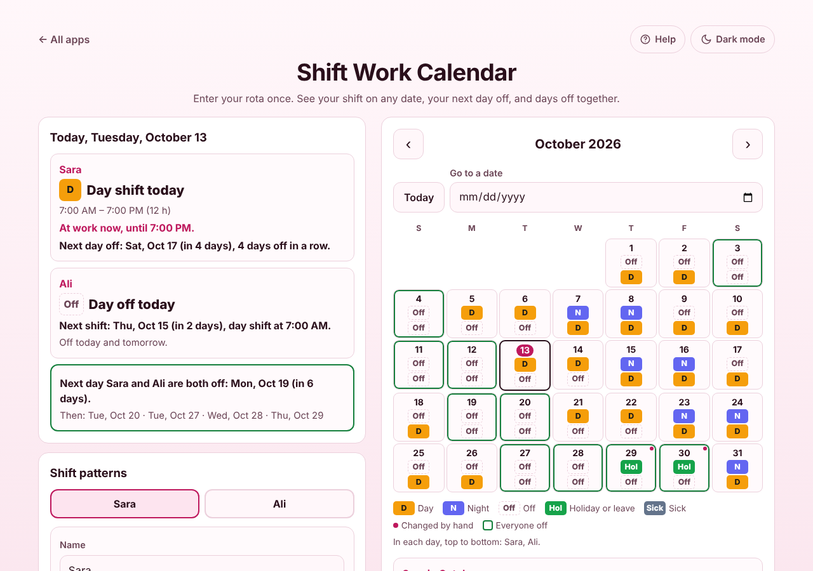

# Shift Work Calendar

A free **shift calendar for rotating rotas**. Enter your pattern once (4 on 4 off, 2 days 2 nights 4 off, Pitman 2-2-3, DuPont, earlies-lates-nights, 24 on 48 off, Monday to Friday, or one you build yourself) and it tells you which shift you are on for any date, when your next day off is, and the days you and your partner or flatmate are all off. Swaps, holidays and sick days are marked by hand without touching the pattern. Shifts can go straight into your phone's calendar. No sign-up, no ads, private on your device and works offline.

**Live demo:** [umar8092.github.io/apps/shift-work-calendar](https://umar8092.github.io/apps/shift-work-calendar/)

| Desktop | On a phone |
|---|---|
|  |  |

## The situation it solves

Sara is a nurse on **2 days, 2 nights, 4 off**. Her first day shift of this run is Tuesday 13 October 2026. A friend asks if she is free on Saturday 14 November, and her partner Ali, on **4 on, 4 off** from Thursday 15 October, wants to know when they can go away together.

She picks her pattern, sets **Day 1 of the pattern is on** to 13 October, and the app answers:

- **Today (Tue 13 Oct): Day shift, 7:00 to 19:00 (12 h). At work now, until 19:00.**
- **Next day off: Sat 17 Oct (in 4 days), 4 days off in a row.**
- Thursday 15 October: **Night shift, 19:00 to 07:00 the next day.** Between midnight and 07:00 on Friday, Today says *At work now: night shift from last night, until 07:00*.
- Saturday 14 November is 32 days after day 1, so it is day 1 again: **Day shift**. Sorry, friend.
- With Ali added: **Next day Sara and Ali are both off: Mon 19 Oct**, then 20 Oct, 27 Oct, 28 Oct and 4 Nov. Those days get a green outline in the calendar.
- October for Sara: **15 shifts (8 day, 7 night), 16 days off, 180 hours**.

When she books 29 and 30 October as holiday, those days show *Hol* with a small dot, the month shows *1 holiday* each, and the pattern itself does not change.

## Features

- **Help button.** Tap **Help** at the top for a short how-to written for this app, and **All apps** to go back to the list.
- **Ready-made rotas:** 4 on 4 off (days or nights), 2 days 2 nights 4 off, 3 days 3 nights 6 off, 3 on 3 off, 2 on 2 off, Pitman 2-2-3 (days only, or 2 weeks days then 2 weeks nights), DuPont, earlies-lates-nights, 24 on 48 off, 24 on 72 off, Monday to Friday.
- **Build your own pattern** up to 14 weeks long by tapping the shift buttons in order. Tap any day of the pattern to change or delete just that day. Remove last day, Clear pattern, and Undo.
- **Each person's own shift times** (night shifts end the next morning, 24-hour shifts), and shift types with your own name, such as a twilight shift.
- **A check line** under the start date says which day of the pattern today is, so a wrong start date is spotted at once.
- **Today:** your shift, whether you are at work right now (also after midnight on a night shift), your next day off and how many days off in a row, or your next shift when you are off.
- **Month calendar** with a coloured box for every shift, arrows, Today and Go to a date (any date from 1900 to 2200, forwards and backwards). Weeks start on Monday or Sunday.
- **Tap a day** for its shift, times and day of the pattern, and to change it: another shift, Off, Holiday or leave, or Sick. **Back to pattern** undoes it.
- **Up to 4 people**, each in their own box with their own pattern. Shows the next days you are all off.
- **Month totals:** shifts by type, days off, holidays, sick days and hours.
- **Share:** Copy this month, Email this month (works with no address typed), Print this month.
- **Calendar file (.ics)** with your shifts for this month or the next 3, 6 or 12 months. Days off are left out. Times have no time zone, so a 07:00 shift stays 07:00.
- **Backup file and restore**, checked before it is loaded. **Start over** with Undo.
- **Private and offline.** Kept only on your device; works with no connection after the first visit and can be installed.
- **Back to all apps** button and a **light and dark mode switch** that remembers your choice.

## Run it yourself

No build step and no dependencies.

```bash
git clone https://github.com/umar8092/apps.git
```

Then open `shift-work-calendar/index.html` in your browser.

Offline mode and install need the files served over `https` or `localhost` (for example `python3 -m http.server`).

## How it works

- `core.js` is the logic, with no page code. Dates are whole calendar days, never clock times, so time zones and summer time can never move a shift. The shift on any date is the pattern day `(date − day 1) mod pattern length`, unless that date was changed by hand.
- `script.js` builds the page. Names are added as plain text, never as HTML.
- `sw.js` saves the app on your device for offline use (network first, so updates show at once).
- Run the checks with `node tests.js` (logic, worked examples) and `node ui-test.js` from the repo root (the page, in a real browser), or open `test.html`.

## License

[MIT](LICENSE). Free to use, copy, modify and share. Made by [Muhammad Umar](https://github.com/umar8092).
