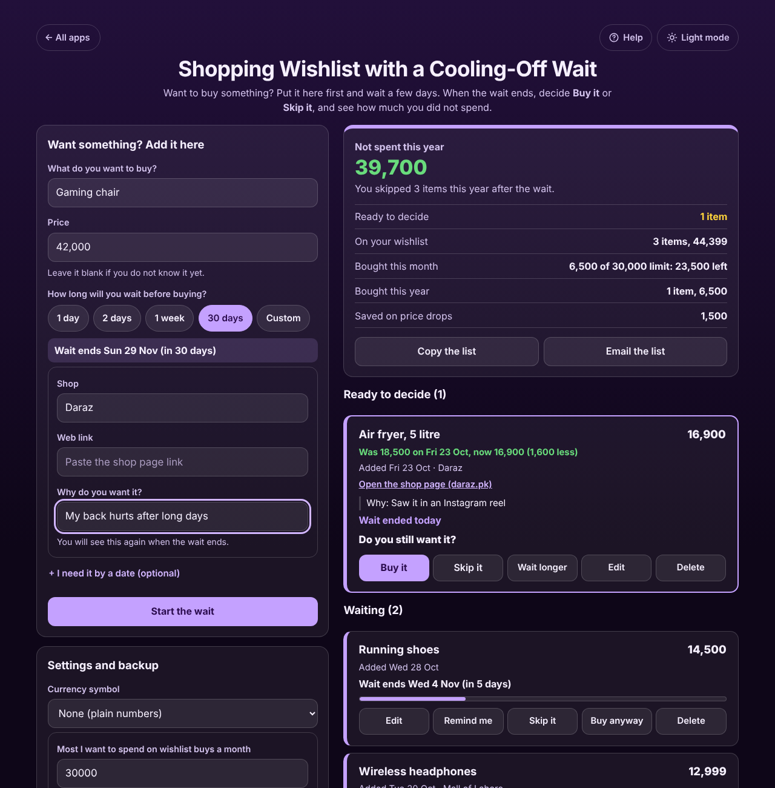
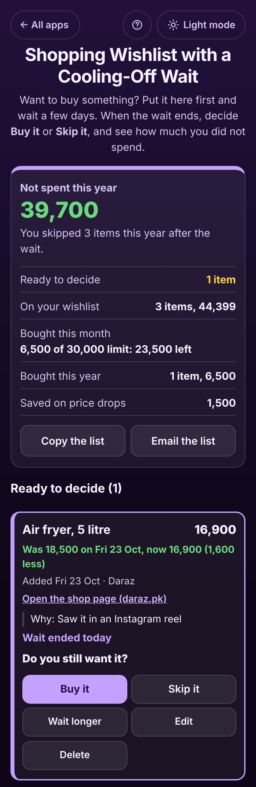

# Shopping Wishlist with a Cooling-Off Wait

A free **shopping wishlist that stops impulse buys**. When you see something you want, put it on the list with its price instead of buying it on the spot, and pick a wait: 1 day, 2 days, 1 week, 30 days or any number of days. When the wait ends the item moves to **Ready to decide** with the reason you wrote, and you tap **Buy it** or **Skip it**. Everything you skip adds up to **Not spent this year**. Price drops while you wait are kept and counted, and an optional monthly limit shows what is left before you buy. No sign-up, no ads, private on your device, and it works offline.

**Live app:** [umar8092.github.io/apps/shopping-wishlist-with-a-cooling-off-wait](https://umar8092.github.io/apps/shopping-wishlist-with-a-cooling-off-wait/)

| Desktop | On a phone |
|---|---|
|  |  |

## The situation it solves

On Friday 23 October Ayesha sees a 5 litre air fryer for **18,500** in an Instagram reel and is about to tap Buy. Last month she did the same with a smart watch she now never wears.

This time she adds it to the list: "Air fryer, 5 litre", **18,500**, wait **1 week**, from Daraz, why: "Saw it in an Instagram reel". The app says **Wait ends Fri 30 Oct (in 7 days)**. On 28 October the price drops and she types **16,900** under Edit. On **Friday 30 October** she opens the app and sees:

- **Ready to decide (1):** "Air fryer, 5 litre: 16,900. **Was 18,500 on Fri 23 Oct, now 16,900 (1,600 less)**. Why: Saw it in an Instagram reel. Wait ended today. **Do you still want it?**"
- **Not spent this year: 39,700**: she skipped a smart watch (25,000), designer sunglasses (12,000) and a second phone case (2,700) after their waits.
- **On your wishlist: 3 items, 44,399**, **Bought this month: 6,500 of 30,000 limit: 23,500 left**, **Saved on price drops: 1,500** (a kettle she bought for 6,500 instead of 8,000).

She taps **Buy it**: the price she paid is filled in as 16,900 and the app says **"This leaves 6,600 of this month's 30,000 limit."** Had she tapped **Skip it**, the 16,900 would have gone into Not spent this year, which would read **56,600**. Not sure yet? **Wait longer** adds 1 more day, 1 more week, 30 more days or any number of days, counted from today once the wait has ended.

Need it soon? **+ I need it by a date** ends the wait on that day if it comes first, and **Buy anyway** before the wait ends is allowed and noted as "before the wait ended". Waits are whole days, so a 1 week wait added on a Friday ends next Friday, and an item whose wait ends at midnight moves to Ready to decide while the app is open.

## Features

- **Help button.** Tap **Help** at the top for a how-to written for this app, and **← All apps** to go back to the list.
- **Add in seconds:** what, price (or blank if you do not know it yet) and the wait. Optional shop, web link (shown as text, opened only on tap), why you want it, and a need-by date.
- **Waits:** 1 day, 2 days, 1 week, 30 days or Custom (1 to 365 days). The day the wait ends is shown before you add it, and your choice is remembered.
- **Each item in its own box** with a bar showing how much of the wait has passed.
- **Ready to decide** at the top: **Buy it** (price paid, with your monthly limit), **Skip it**, **Wait longer**, plus **Edit** and **Delete**. **Undo** after every change.
- **Price history:** a new price is kept with the old one, so you see "Was 18,500, now 16,900 (1,600 less)".
- **Warnings:** the same item already on your list, or one you skipped or bought before.
- **Totals:** Not spent this year (and all time), what is on your wishlist, bought this month against an optional monthly limit, bought this year, and saved on price drops.
- **Decided:** what you **Skipped** and **Bought**, with **Put back on the list**.
- **Remind me:** a calendar file with a reminder at 9 in the morning on the day the wait ends.
- **Copy the list** and **Email the list** (opens your mail app, no address needed).
- **Currency symbol** of your choice (or none), remembered.
- **Backup file** to move to another phone, and **Delete everything**, with Undo.
- **Private.** Everything stays in your browser. Your data is never sent anywhere.
- **Works offline and installable.** Light and dark mode switch next to the back button, remembered across all apps. Laptop layout with adding on the left and the totals and list on the right.

## Run it yourself

No build step and no dependencies.

```bash
git clone https://github.com/umar8092/apps.git
```

Then open `shopping-wishlist-with-a-cooling-off-wait/index.html` in your browser.

Offline mode and install need the files served over `https` or `localhost` (for example `python3 -m http.server`).

## How it works

- `core.js` is the dates, the money and the words, with no page code. Money is whole cents and dates are whole days, so totals are exact. `endFor()` works out the day a wait ends (with the need-by date), `status()` says whether an item is waiting or ready, `waitLonger()`, `decide()` and `setPrice()` change an item, `summary()` adds up the totals, and `ics()` writes the calendar reminder.
- `script.js` builds the page. Names and notes are added as plain text, never as HTML, and links are kept only if they are plain `http` or `https` addresses. Everything is saved in this browser's storage under `shopping-wishlist-with-a-cooling-off-wait.state`, and saved or restored data is checked before use.
- `sw.js` keeps a copy of the app for offline use. It is network first, so you always get the newest version when online.
- Tests: `node tests.js` (the maths and words) and `node ui-test.js` (drives the real page in headless Chromium at many screen sizes).

## License

[MIT](LICENSE)
