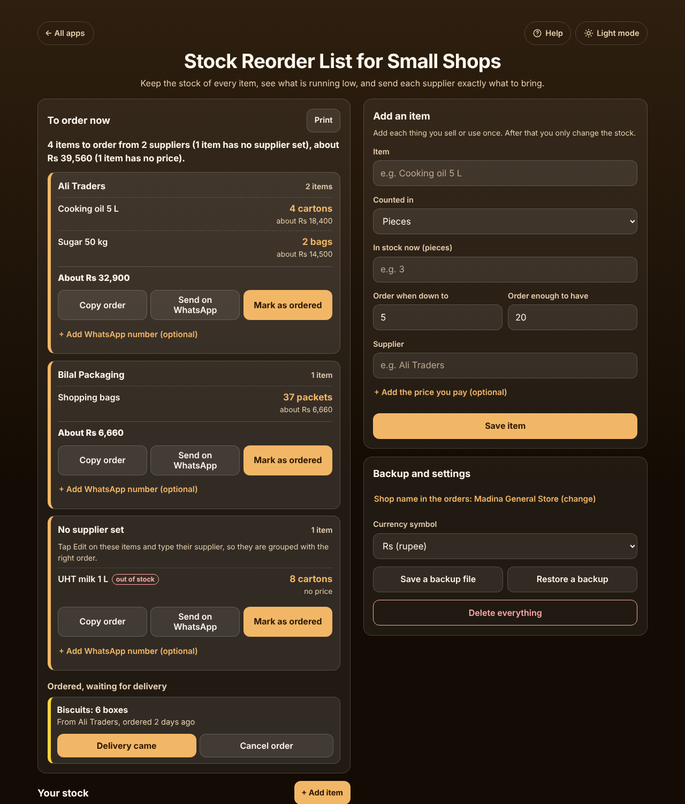
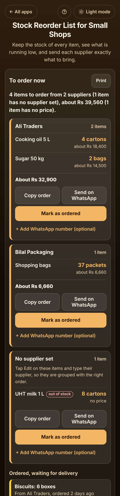

# Stock Reorder List for Small Shops

A free **stock reorder list for a small shop**: a kiryana or general store, a pharmacy counter, a salon or a cafe. Each item keeps its own unit, supplier, stock and order level. Tap − and + as stock is used, or type what you counted, and the app lists **exactly what to order from each supplier** with the estimated cost. Copy the order or send it on WhatsApp, mark it as ordered so nothing is ordered twice, and add the delivery to the stock when it comes. No sign-up, no ads, private on your device, works offline. No currency is forced: pick a symbol or use plain numbers.

**Live app:** [umar8092.github.io/apps/stock-reorder-list-for-small-shops](https://umar8092.github.io/apps/stock-reorder-list-for-small-shops/)

| Desktop | On a phone |
|---|---|
|  |  |

## The situation it solves

Ahmed runs a general store. On Saturday he notices the cooking oil, sugar and shopping bags are almost gone, and when the Ali Traders salesman calls he forgets half of them. With this app each item has its own box:

| Item | Counted in | In stock | Order when down to | Order enough to have | Supplier | Price |
|---|---|---|---|---|---|---|
| Cooking oil 5 L | carton | 2 | 2 | 6 | Ali Traders | 4,600 |
| Sugar 50 kg | bag | 1 | 1 | 3 | Ali Traders | 7,250 |
| Shopping bags | packet | 3 | 10 | 40 | Bilal Packaging | 180 |
| UHT milk 1 L | carton | 0 | 2 | 8 | (not set yet) | (not set) |
| Rice 25 kg | bag | 5 | 2 | 6 | Ali Traders | 9,000 |

The app answers in plain words:

- **4 items to order from 2 suppliers (1 item has no supplier set), about 39,560 (1 item has no price).**
- **Ali Traders:** Cooking oil 5 L **4 cartons** (about 18,400), Sugar 50 kg **2 bags** (about 14,500). **About 32,900.**
- **Bilal Packaging:** Shopping bags **37 packets** (about 6,660).
- **No supplier set:** UHT milk 1 L **8 cartons**, *out of stock*, no price.
- Rice is not listed: 5 bags is above its order level of 2.

**Copy order** gives a message with no prices, ready for the supplier:

```
Hello Ali Traders, please send to Madina General Store:
1. Cooking oil 5 L: 4 cartons
2. Sugar 50 kg: 2 bags
Order of Mon 26 Oct 2026. Thank you.
Madina General Store
```

After sending it he taps **Mark as ordered**. The two items move to *Ordered, waiting for delivery*, so they are not ordered again even if more oil is sold meanwhile. On Tuesday only 3 cartons of oil arrive at a new price of 4,700: **Delivery came** → 3 → 4700 → **Add to stock** says *"Cooking oil 5 L: 3 cartons added. Now 4 cartons in stock. (1 carton less than ordered.)"* and the new price is used next time.

## Features

- **Each item in its own box** with its own unit (pieces, packets, cartons, boxes, bags, sacks, kg, litres, bottles, tins, dozen, rolls, trays, medicine strips, or your own), supplier, order level, full level and price.
- **Sensible presets.** The two levels are filled in for the unit you pick (for example order at 2 cartons, up to 6) and you change them for each item.
- **− and + or type the count.** Decimals work (2.5 kg). Each item shows when it was last counted and its last delivery.
- **To order now**, grouped by supplier, with the quantity, the estimated cost from the last price, the total per supplier and for all suppliers. Items with no price are named, never guessed. Out-of-stock items are marked.
- **Copy order** and **Send on WhatsApp** (to the supplier's number if you add one, or pick the chat yourself). Your shop name can be added to every order.
- **Mark as ordered**, **Delivery came** (change the quantity if less came, and the price) and **Cancel order**, for a whole supplier or one item.
- **To order / On order / All** tabs, and a search box once you have many items.
- **Edit**, **No longer sold** (kept aside, **Sell again** brings it back) and **Delete**. Every change has **Undo**.
- **Print** the list or save it as a PDF.
- **Currency symbol** (none, Rs, ₹, $, €, £ and more), remembered.
- **Backup file** and **Restore**, to move to another phone. **Delete everything** with Undo.
- **Help button.** Tap **Help** at the top for a short how-to written for this app, and **← All apps** to go back to the list.
- **Light and dark mode switch.** It follows your device until you choose, and remembers your choice in every app.
- **Private and offline.** Everything stays on your device and your data is never sent anywhere. Installable, works with no connection.

## Run it yourself

No build step and no dependencies.

```bash
git clone https://github.com/umar8092/apps.git
```

Then open `stock-reorder-list-for-small-shops/index.html` in your browser.

Offline mode and install need the files served over `https` or `localhost` (for example `python3 -m http.server`).

## How it works

- `core.js` is the logic, with no page code. Quantities are whole hundredths (2.5 kg is 250) and money is whole cents, so every order quantity and total is exact. An item is listed when its stock is at or below **Order when down to**, and the amount to order is **Order enough to have** minus the stock.
- `script.js` builds the page. Names are added as plain text, never as HTML. Everything is saved in your browser's local storage under `stock-reorder-list-for-small-shops.state`, and checked when it is loaded or restored.
- `sw.js` saves the app on your device for offline use (network first, so an update shows at once).
- Run the checks with `node tests.js` (or open `test.html`), and the page test with `node ui-test.js` against a local server.

## License

[MIT](LICENSE). Free to use, copy, modify and share. Made by [Muhammad Umar](https://github.com/umar8092).
