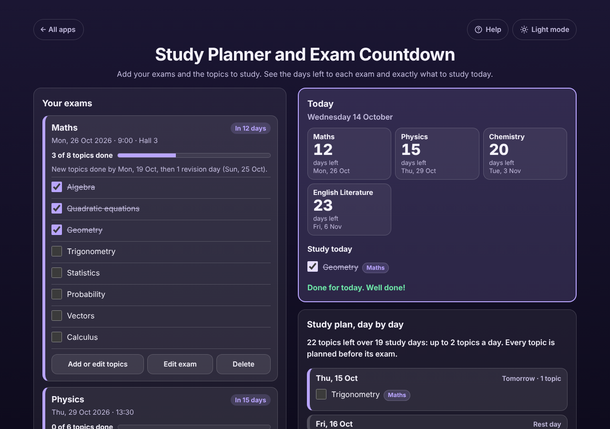

# Study Planner and Exam Countdown

A free **study planner for students** with exams coming up. Add each exam with its date and the topics you need to study (paste them straight from your syllabus). The app shows how many days are left to every exam and exactly what to study today, and builds a day-by-day revision timetable that spreads the topics evenly, earliest exam first, keeps revision days free before each exam and works around your days off. Tick topics as you go; if you fall behind or study ahead, the plan adjusts by itself. No ads, no sign-up, private on your device, works offline.

**Live demo:** [umar8092.github.io/apps/study-planner-and-exam-countdown](https://umar8092.github.io/apps/study-planner-and-exam-countdown/)

| Desktop | On a phone |
|---|---|
|  |  |

## The situation it solves

Ayesha has four exams in the next three weeks and a pile of chapters. She keeps asking herself "what should I study today, and am I going to finish in time?". It is Wednesday 14 October. She adds:

| Exam | Date | Topics | Revision days |
|---|---|---|---|
| Maths | Mon 26 Oct, 9:00, Hall 3 | 8 (Algebra, Quadratic equations, Geometry, ...) | 1 |
| Physics | Thu 29 Oct | 6 | 1 |
| Chemistry | Tue 3 Nov | 7 | 2 |
| English Literature | Fri 6 Nov | 4 | 1 |

She keeps Fridays free, has a cousin's wedding on Saturday 31 October, and has already done Algebra and Quadratic equations. The app answers in plain words:

- **Countdown:** Maths in **12 days**, Physics **15**, Chemistry **20**, English Literature **23**.
- **Study today:** Geometry (Maths).
- **The plan:** "23 topics left over 19 study days: up to 2 topics a day. Every topic is planned before its exam." Friday 16 Oct is a rest day; Sunday 25 Oct says "Revise Maths: go over all 8 topics"; Monday 26 Oct says "EXAM: Maths at 9:00, Hall 3".
- **Each exam box:** "New topics done by Mon 19 Oct, then 1 revision day (Sun 25 Oct)."

She ticks Geometry and gets "Done for today. Well done!", and the rest of the plan stays exactly as it was. She skips a day? The topics she did not tick are spread again over the days that are left. She studied a Chemistry chapter early? Ticking it puts it on today's list and the later days get lighter, but Maths still gets the time it needs. If an exam is too close (for example 14 Biology topics with only one study day left) the plan says so: "Busy plan: up to 15 topics on one day" and "Biology: only 1 study day left, so no revision day instead of 1".

## Features

- **Help button.** Tap **Help** at the top for a short how-to written for this app, and tap **All apps** to go back to the list.
- **Exam countdown** for every coming exam, with the date, and the exam marked when it is 3 days away or less.
- **Study today**: the topics for today with a tick box each, plus revision days and exam days, and "Done for today" when they are all ticked.
- **Day-by-day plan** from tomorrow to your last exam, with rest days, days off, revision days and exams, 14 days at a time.
- **Fair, exact spreading.** Earliest exam first, as evenly as the dates allow: each day gets the number of topics that keeps every exam on track, so nothing is left to the last minute and no day is busier than it needs to be. Topics are studied in the order you typed them.
- **Each exam its own settings**: date, optional time and place, and its own number of revision days (none to 14).
- **Paste a topic list**: one per line or separated by commas; bullets and numbers such as "1." or "a)" are removed and repeats skipped.
- **Edit topics as text**: add, rename, reorder or delete lines; ticks are kept for topics you did not rename. With **Undo**.
- **When you can study**: tap the weekdays you never study (such as Friday) and add one-off days off (a wedding, a trip).
- **Plain warnings** when an exam has no study day left, when there is no room for the revision days you asked for, or when the plan gets busy.
- **Share**: *Copy the plan*, *Email the plan* (no address needed first), *Print or save as PDF* for your wall, and *Add exams to my calendar* (a calendar file with every exam and a reminder the day before).
- **Backup**: *Save a backup file* and *Restore a backup*, with *Undo*. *Delete everything* also has *Undo*.
- **Moves on by itself** at midnight, so the plan always starts from today.
- **Private.** Everything stays in this browser on this device. Your data is never sent anywhere.
- **Works offline and installable.** Add it to your home screen.
- **Back to all apps.** A "← All apps" button at the top of the page.
- **Light and dark mode switch.** It follows your device until you choose, and remembers your choice in every app.

## Run it yourself

No build step and no dependencies.

```bash
git clone https://github.com/umar8092/apps.git
```

Then open `study-planner-and-exam-countdown/index.html` in your browser.

Offline mode and install need the files served over `https` or `localhost` (for example `python3 -m http.server`).

## How it works

- `core.js` is the dates, the plan and the words, with no page code. Dates are plain `YYYY-MM-DD` days counted in UTC, so summer-time changes never move a day. For each day, the plan takes, for every exam together with all earlier ones, the topics left divided by the study days left before that exam's revision days, rounded, and uses the largest of these. Topics are taken earliest exam first. This keeps every exam on track, never needs more than one topic a day above the best possible busiest day, and does not change when you tick today's topics.
- `script.js` builds the page. Subjects, topics and places are added as plain text, never as HTML.
- `sw.js` saves the app on your device for offline use (network first, so you always get the newest version when online).
- Run the checks with `node tests.js` (or open `test.html`) for the plan, including 600 random plans, and `node ui-test.js` to drive the page in headless Chromium.

## License

[MIT](LICENSE). Free to use, copy, modify and share. Made by [Muhammad Umar](https://github.com/umar8092).
