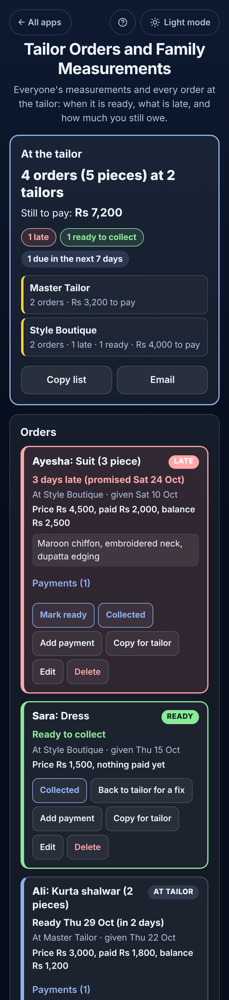

# Tailor Orders and Family Measurements

A free **tailor diary for families** who have clothes stitched: **shalwar kameez, kurtas, suits, school uniforms, dresses and alterations**. Keep **each person's measurements** in their **own box** (shirt or kameez, shalwar or trousers, in **inches or cm**, typed the way tailors write them, like 14½), with **older sets kept** so you can see how much a child has grown. Then keep **every order at the tailor**: who it is for, which tailor, the **ready date** they promised, the **price, the advance and the balance**. One look tells you **what is late, what is ready to collect and how much you still owe each tailor**, and **Copy for tailor** sends the order with the person's measurements on WhatsApp. Works offline, no sign-up, no ads.

**Live demo:** [umar8092.github.io/apps/tailor-orders-and-family-measurements](https://umar8092.github.io/apps/tailor-orders-and-family-measurements/)

| Desktop | On a phone |
|---|---|
| ![Tailor Orders and Family Measurements on a laptop: At the tailor says 4 orders (5 pieces) at 2 tailors, still to pay Rs 7,200, 1 late, 1 ready to collect, 1 due in the next 7 days, Master Tailor 2 orders Rs 3,200 to pay, Style Boutique 2 orders 1 late 1 ready Rs 4,000 to pay; below it Ayesha's Suit (3 piece) in red, 3 days late (promised Sat 24 Oct), price Rs 4,500, paid Rs 2,000, balance Rs 2,500; on the right the Give clothes to the tailor form with the family's names, item suggestions and ready-date buttons](screenshots/desktop.png) |  |

## The situation it solves

Ayesha in Lahore has clothes stitched for the whole family before Eid and a wedding. Her husband **Imran**, her son **Ali** (10) and her daughter **Sara** go to two tailors. Every time she cannot find the measurements, forgets which tailor has which suit, when it was promised, and how much advance she already paid.

On **Tue 27 Oct 2026** the app answers:

- **At the tailor: 4 orders (5 pieces) at 2 tailors. Still to pay: Rs 7,200.** 1 late, 1 ready to collect, 1 due in the next 7 days.
- **Master Tailor:** 2 orders, Rs 3,200 to pay. **Style Boutique:** 2 orders, 1 late, 1 ready, Rs 4,000 to pay.
- **Ayesha: Suit (3 piece), 3 days late (promised Sat 24 Oct).** At Style Boutique, given Sat 10 Oct. Price Rs 4,500, paid Rs 2,000, **balance Rs 2,500**. Shown first, in red: this is the tailor to call.
- **Sara: Dress, ready to collect.** Price Rs 1,500, nothing paid yet.
- **Ali: Kurta shalwar (2 pieces), ready Thu 29 Oct (in 2 days).** Price Rs 3,000, paid Rs 1,800, **balance Rs 1,200**.
- **Imran: Shalwar kameez, no ready date.** Price Rs 2,000, nothing paid yet.
- **Collected (1):** Ali's school uniform, collected Thu 22 Oct, Rs 1,600 fully paid.

1,200 + 2,500 + 1,500 + 2,000 = **Rs 7,200** still to pay (the collected uniform is paid and not counted).

**Ali's box** says *Measured Thu 12 Mar 2026 (7 months ago). Measure again before the next order*, and shows what changed since the earlier set: **Shirt / kameez length 28 → 30, Chest 26½ → 28, Sleeve length 17 → 18½, Shalwar / trouser length 29 → 31**. **Copy measurements** gives the tailor:

```
Ali measurements (inches, taken Thu 12 Mar 2026)

Shirt / kameez
Length: 30
Shoulder: 13
Chest: 28
Waist: 26
Sleeve length: 18½
Neck / collar: 12½

Shalwar / trousers
Length: 31
Bottom / paicha: 6½
```

At pickup the boutique asks Rs 5,000 instead of Rs 4,500 for Ayesha's suit. She taps **Collected**, changes the **Final price** to 5,000 and types what she paid. If she pays Rs 3,200, the app says **"You paid Rs 200 more than the price."** If the sleeves are too long, **Back to tailor for a fix** sends it back with a new ready date and keeps a note of the fix.

How it counts: an order is **late** when its ready date has passed and it is not marked Ready or Collected. "Ready today" is not late. "In 1 week" counts from the day you gave the clothes. Money is kept in whole cents, so every total is exact. **14½, 14 1/2, 14-1/2, 14.5 and 14,5** all mean the same. Switching between inches and cm converts to the nearest ¼ inch or 0.5 cm (14½ in = 37 cm).

## Features

- **Help button.** Tap **Help** at the top for a short how-to written for this app, and tap **All apps** to go back to the list.
- **At the tailor** at the top: how many orders at how many tailors, **still to pay**, how many are late, ready or due this week, and **each tailor's own count and balance**. **Copy list**, **Share** or **Email** (no address needed first).
- **Each order in its own bordered box**: late ones first in red, then ready to collect in green, then by ready date. Each shows the tailor, the day given, the ready date, the price, paid and balance, and the fabric and design note.
- **Give clothes to the tailor** in seconds: tap the person (or **Someone else**), tap a suggestion (Shalwar kameez, Kurta, Suit (3 piece), Shirt, Trousers, School uniform, Dress, Alteration) or type your own, how many pieces, the tailor (your tailors come back as one-tap buttons), the day given and **In 3 days, In 1 week, In 2 weeks, a date or Not set**. **The tailor and dates stay filled in**, so five Eid suits for one tailor take a minute.
- **Optional, never forced:** price and advance, and a fabric and design note.
- **Mark ready** when the tailor calls, **Collected** with a changed **final price** and what you paid, **Add payment** at any time (with **Remove**), **Back to tailor for a fix** with a new ready date, **Edit** and **Delete**. Undo after every change.
- **Family measurements:** each person in their own box with their own unit (inches or cm), 16 common measurements for a shirt or kameez and for shalwar or trousers, **your own extra measurements** (like Collar style: Ban), a **fit note**, and the date measured.
- **New measurements** keeps the old set under **Earlier measurements** and shows **what changed**. Measurements 6 months old or more are marked so you measure again. **Edit** fixes a typo without a new set.
- **Copy measurements** and **Copy for tailor** (the order plus the person's measurements) to paste into WhatsApp.
- **Order for** in a person's box starts an order for them. Renaming a person renames their orders; deleting a person keeps their orders.
- Optional **currency symbol** (None, Rs, PKR, ₹, $, €, £, AED, SAR, ৳ and more), remembered.
- **Save a backup file**, **Restore a backup**, **Delete everything** with Undo. Damaged or blocked saved data is handled with a clear message.
- **Private.** Everything stays in this browser on this device; your data is never sent anywhere.
- **Works offline and installable.** Late and due dates update by themselves at midnight.
- **Back to all apps.** A "← All apps" button at the top of the page.
- **Light and dark mode switch.** It follows your device until you choose, and remembers your choice in every app.

## Run it yourself

No build step and no dependencies.

```bash
git clone https://github.com/umar8092/apps.git
```

Then open `tailor-orders-and-family-measurements/index.html` in your browser.

Offline mode and install work best with the files served over `https` or `localhost` (for example `python3 -m http.server`).

## How it works

- `core.js` is the logic, with no page code. Dates are calendar dates (`2026-10-27`), so time zones and summer time never move a date. Money is kept in whole cents. It reads measurements typed as decimals or fractions, shows inches the way tailors write them (14½, 38¾), converts inches and cm, works out what changed between two sets, each order's status (late, ready, due, no date, collected), balance and the At the tailor summary, builds the texts for the tailor, reads the order form with plain error messages, and checks every saved or restored value.
- `script.js` builds the page. Names and notes are added as plain text, never as HTML. Everything is saved in `localStorage` on the device.
- `sw.js` saves the app on your device for offline use (network first, so updates show at once).
- Run the logic checks with `node tests.js` (or open `test.html`), and the full page test with `node ui-test.js` (needs Playwright). The page test fixes the time to Tue 27 Oct 2026, 10:00 am, and checks the exact answers above.

## License

[MIT](LICENSE). Free to use, copy, modify and share. Made by [Muhammad Umar](https://github.com/umar8092).
