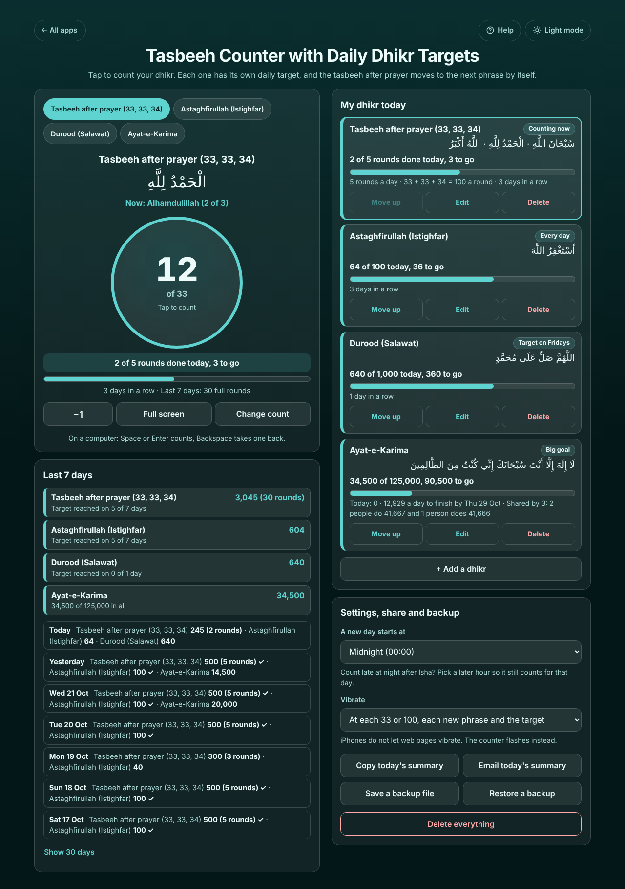

# Tasbeeh Counter with Daily Dhikr Targets

A free **online tasbeeh and dhikr counter**. Tap the big circle to count. Each dhikr has its **own daily target** (100 istighfar every day, 1,000 durood only on Fridays), the **tasbeeh after prayer** (33 SubhanAllah, 33 Alhamdulillah, 34 Allahu Akbar) moves to the next phrase by itself and counts rounds, and a **big goal** such as a family's 1,25,000 Ayat-e-Karima shows what is left, how many a day are needed and each person's share. It keeps your streak and the last 7 (or 30) days, has a dark full-screen mode that keeps the screen on, and vibrates at each 33 or 100 on Android. The app only counts; it gives no religious rulings. No sign-up, no ads, private on your device, works offline.

**Live demo:** [umar8092.github.io/apps/tasbeeh-counter-with-daily-dhikr-targets](https://umar8092.github.io/apps/tasbeeh-counter-with-daily-dhikr-targets/)

| Desktop | On a phone |
|---|---|
|  |  |

## The situation it solves

Ayesha does the tasbeeh after every prayer, 100 istighfar a day, and 1,000 durood every Friday. On a bead tasbeeh she loses count when someone talks to her, and she never knows how many durood she has left on a busy Friday. Her family is also reading 1,25,000 Ayat-e-Karima together before a gathering on Thursday.

It is Friday 23 October, mid-afternoon. The app shows:

- **Tasbeeh after prayer (33, 33, 34): Now: Alhamdulillah (2 of 3), 12 of 33.** She has tapped 245 times today: 2 full rounds of 100 (33 + 33 + 34), then 33 SubhanAllah and 12 Alhamdulillah. **2 of 5 rounds done today, 3 to go. 3 days in a row.**
- **Astaghfirullah (Istighfar): 64 of 100 today, 36 to go.**
- **Durood (Salawat): 640 of 1,000 today, 360 to go.** Its target is only on Fridays, so the days in between do not break her streak; on Saturday it says **0 today (no target on Saturdays)**.
- **Ayat-e-Karima: 34,500 of 125,000, 90,500 to go. 12,929 a day to finish by Thu 29 Oct. Shared by 3: 2 people do 41,667 and 1 person does 41,666.** (23 to 29 Oct is 7 days counting today; 90,500 ÷ 7 = 12,928.6, rounded up. 125,000 ÷ 3 = 41,666 r 2.) When her sister sends "I did 5,000", she taps **Change count**, types 5000 and **Add to today**.

Tapped by mistake? **−1** takes back one. Lost count completely? **Change count**, type the right number, **Set today to this**. At night she uses **Full screen**: the whole dark screen is one button and the screen stays on. **Copy today's summary** gives text to paste in the family WhatsApp group.

## Features

- **Help button.** Tap **Help** at the top for a short how-to written for this app, and tap **All apps** to go back to the list.
- **A big tap circle** with the count, the target ("of 100") and a progress bar. Space or Enter count on a computer, Backspace takes one back.
- **Three kinds of dhikr, each in its own box with its own settings:**
  - **Daily target** (33, 100, 300, 500, 1,000 or any number), every day or **only some days** such as Fridays, and when to buzz (every 33, every 100, or only at the target).
  - **Set in order:** phrases with their own counts (33, 33, 34 by default, or your own words), moving to the next one by itself, with rounds a day (1, 3, 5 or any number up to 50).
  - **Big goal:** one total over many days, an optional **finish date** (how many a day you still need) and optional **number of people** (each person's exact share).
- Nine common phrases with Arabic text built in, or **My own words**; Arabic is optional.
- **−1**, **Change count** (Add to today, Set today to this, +1 full round, Reset today to 0 with Undo).
- **Full screen** counting: dark, one huge button, the screen kept on where the browser allows it.
- **Vibrate** at each 33 or 100, each new phrase and the target, on every tap, or never (Android; iPhones flash instead).
- **Streaks** (days in a row the target was reached), **Last 7 days** totals with how many days the target was reached, and each day's counts (**Show 30 days**).
- **A new day starts at** midnight or 02:00 to 06:00, so late-night dhikr can count for the day before.
- **Edit**, **Move up**, **Delete** with Undo, **Start this goal again from 0** with Undo.
- **Copy today's summary** (for WhatsApp) and **Email today's summary** (works with no address typed), **Save a backup file**, **Restore a backup**, **Delete everything** with Undo.
- **Private.** Your data is never sent anywhere; it stays in this browser on this device.
- **Works offline and installable.** Phone friendly, with a two-column layout on laptops.
- **Back to all apps.** A "← All apps" button at the top of the page.
- **Light and dark mode switch.** It follows your device until you choose, and remembers your choice in every app.

## Run it yourself

No build step and no dependencies.

```bash
git clone https://github.com/umar8092/apps.git
```

Then open `tasbeeh-counter-with-daily-dhikr-targets/index.html` in your browser.

Offline mode and install need the files served over `https` or `localhost` (for example `python3 -m http.server`).

## How it works

- `core.js` is the logic, with no page code. Each day keeps one whole number per dhikr: the taps. For a set, the phrase and the round are worked out from that number (245 taps of 33 + 33 + 34 = 2 rounds, then Alhamdulillah 12), so −1 always undoes exactly one tap. A big goal adds up every day. The counting day is the date of "now minus the hour a new day starts".
- `script.js` builds the page. Names are added as plain text, never as HTML.
- `sw.js` saves the app on your device for offline use (network first, so you always get the newest version when online).
- Run the logic checks with `node tests.js` (or open `test.html`), and the full page test with `node ui-test.js` (needs Playwright).

## License

[MIT](LICENSE). Free to use, copy, modify and share. Made by [Muhammad Umar](https://github.com/umar8092).
