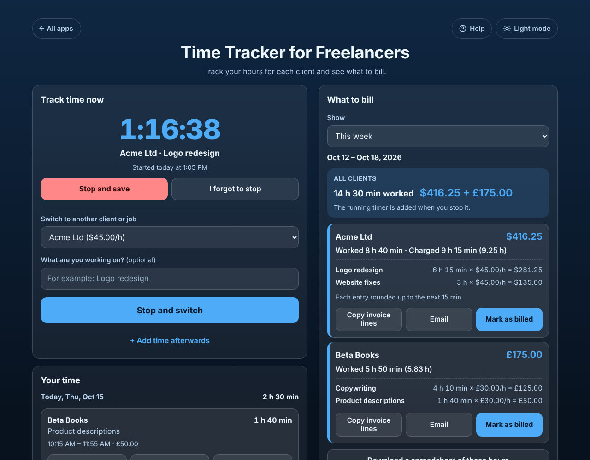

# Time Tracker for Freelancers

A free **time tracker for freelancers** who bill by the hour. Choose a client and tap **Start timer**, or add time you already worked afterwards, and the app shows **the hours and the money for each client** this week, last week, this month or any dates, with each client's own hourly rate, currency and rounding. Copy the hours as **invoice lines**, email them, **mark them as billed** so nothing is billed twice, and download a spreadsheet. No sign-up, no ads, private on your device, works offline.

**Live demo:** [umar8092.github.io/apps/time-tracker-for-freelancers](https://umar8092.github.io/apps/time-tracker-for-freelancers/)

| Desktop | On a phone |
|---|---|
|  |  |

## The situation it solves

Sara is a freelance designer with two clients. **Acme Ltd** pays **$45 an hour** and wants time rounded **up to the next 15 minutes**. **Beta Books** pays **£30 an hour** for the exact minutes. During the week of 12 to 18 October 2026 she taps **Start timer** when she starts work and **Stop and save** when she finishes (and adds one forgotten session with **+ Add time afterwards**):

| Day | Client | Work | Time | Worked | Charged |
|---|---|---|---|---|---|
| Mon 12 | Acme Ltd | Logo redesign | 9:00 – 11:20 | 2 h 20 min | 2 h 30 min |
| Mon 12 | Acme Ltd | Website fixes | 13:00 – 14:05 | 1 h 05 min | 1 h 15 min |
| Tue 13 | Acme Ltd | Logo redesign | 9:30 – 12:10 | 2 h 40 min | 2 h 45 min |
| Tue 13 | Beta Books | Copywriting | 14:00 – 16:30 | 2 h 30 min | 2 h 30 min |
| Wed 14 | Acme Ltd | Website fixes | 10:00 – 11:45 | 1 h 45 min | 1 h 45 min |
| Wed 14 | Beta Books | Copywriting | 13:30 – 15:10 | 1 h 40 min | 1 h 40 min |
| Thu 15 | Acme Ltd | Logo redesign | 9:10 – 10:00 | 50 min | 1 h |
| Thu 15 | Beta Books | Product descriptions | 10:15 – 11:55 | 1 h 40 min | 1 h 40 min |

On Thursday afternoon, **What to bill** for **This week** answers:

- **All clients:** 14 h 30 min worked, **$416.25 + £175.00** (two currencies are never added together).
- **Acme Ltd: $416.25.** Worked 8 h 40 min, charged 9 h 15 min (9.25 h). Logo redesign 6 h 15 min × $45.00/h = $281.25, Website fixes 3 h × $45.00/h = $135.00.
- **Beta Books: £175.00.** Worked 5 h 50 min (5.83 h). Copywriting 4 h 10 min × £30.00/h = £125.00, Product descriptions 1 h 40 min × £30.00/h = £50.00.

She taps **Copy invoice lines** for Acme and pastes this into her invoice:

```
Acme Ltd - Oct 12 – Oct 18, 2026
Logo redesign: 6 h 15 min (6.25 h) x $45.00/h = $281.25
Website fixes: 3 h (3.00 h) x $45.00/h = $135.00
Total: 9 h 15 min (9.25 h) = $416.25
Each entry rounded up to the next 15 minutes.
```

Then she taps **Mark as billed**. Those hours now show **Billed** and drop out of **Not billed yet**, and they keep the $45 rate even when she raises Acme to $50 next month.

How it counts: each entry is rounded up on its own (1 h 05 min up to 15 minutes is 1 h 15 min), the charged minutes for each kind of work are added up, and the money is minutes × rate ÷ 60, to the cent (7 minutes at 40.00 an hour is 4.67). Time past midnight belongs to the day it started.

## Features

- **Help button.** Tap **Help** at the top for a short how-to written for this app, and tap **All apps** to go back to the list.
- **One timer, one tap.** Start, **Stop and save**, or choose another client and tap **Stop and switch** (the first timer is saved, so two never run at once). The clock keeps counting when the page is closed or the phone is locked, and shows in the browser tab.
- **Forgot to stop?** After 8 hours the app asks. **I forgot to stop** saves only the time until the moment you choose; a stop time before the start or in the future is refused. **Throw this timer away** with Undo. Under 30 seconds is not saved, so a mistaken tap does no harm.
- **Add time afterwards** with **Start and finish** (past midnight works and says so) or **Just how long** (1:30, 1h 30m, 1.5, 45m). An overlap with saved time is pointed out. Future days are refused.
- **Each client its own settings:** hourly rate (optional: no rate shows hours only), currency symbol (none, $, €, £, ₹, Rs, ¥ and more) and rounding (exact minutes, or up to the next 6, 15 or 30 minutes). A new rate can also apply to time not billed yet; billed time never changes.
- **Your time by day**, newest first, with each day's total. Each entry is its own box with the times, how long, what is charged and the money. **Continue**, **Edit** (client, work, day, times, **Charge for this time**, **Already billed**) and **Delete** with Undo.
- **What to bill** for this week, last week, this month, last month, **Not billed yet (all dates)** or chosen dates; week starting Monday, Sunday or Saturday. Each client in its own box with worked and charged hours, decimal hours and one line for each kind of work.
- **Copy invoice lines**, **Email** (opens your email with no address needed), **Mark as billed** with Undo, and **Download a spreadsheet** (CSV) of every entry.
- **Save a backup file** and **Restore a backup** to move to a new device; **Delete everything** with Undo. Damaged or blocked saved data is handled with a clear message.
- **Private.** Your clients, rates and hours stay in this browser on this device; your data is never sent anywhere.
- **Works offline and installable** on a phone or computer.
- **Back to all apps.** A "← All apps" button at the top of the page.
- **Light and dark mode switch.** It follows your device until you choose, and remembers your choice in every app.

## Run it yourself

No build step and no dependencies.

```bash
git clone https://github.com/umar8092/apps.git
```

Then open `time-tracker-for-freelancers/index.html` in your browser.

Offline mode and install work best with the files served over `https` or `localhost` (for example `python3 -m http.server`).

## How it works

- `core.js` is the logic, with no page code. Money is whole cents and time whole seconds, so totals are exact. Days are calendar dates (`2026-10-15`), so a saved entry never moves when you travel. It reads typed rates (40, $40.50, 1,200, 40,5) and lengths (1:30, 1h 30m, 1.5), rounds each entry the client's way, groups invoice lines by work and rate, and checks every saved or restored value.
- `script.js` builds the page. Names and notes are added as plain text, never as HTML. Everything is saved in `localStorage` under `time-tracker-for-freelancers.state`. A running timer is saved as its start time, so it survives a reload.
- `sw.js` saves the app on your device for offline use (network first, so updates show at once).
- Run the logic checks with `node tests.js` (or open `test.html`), and the full page test from the repo root with `node time-tracker-for-freelancers/ui-test.js` (needs Playwright). The page test fixes the clock to 15 Oct 2026 and checks the exact answers.

## License

[MIT](LICENSE). Free to use, copy, modify and share. Made by [Muhammad Umar](https://github.com/umar8092).
