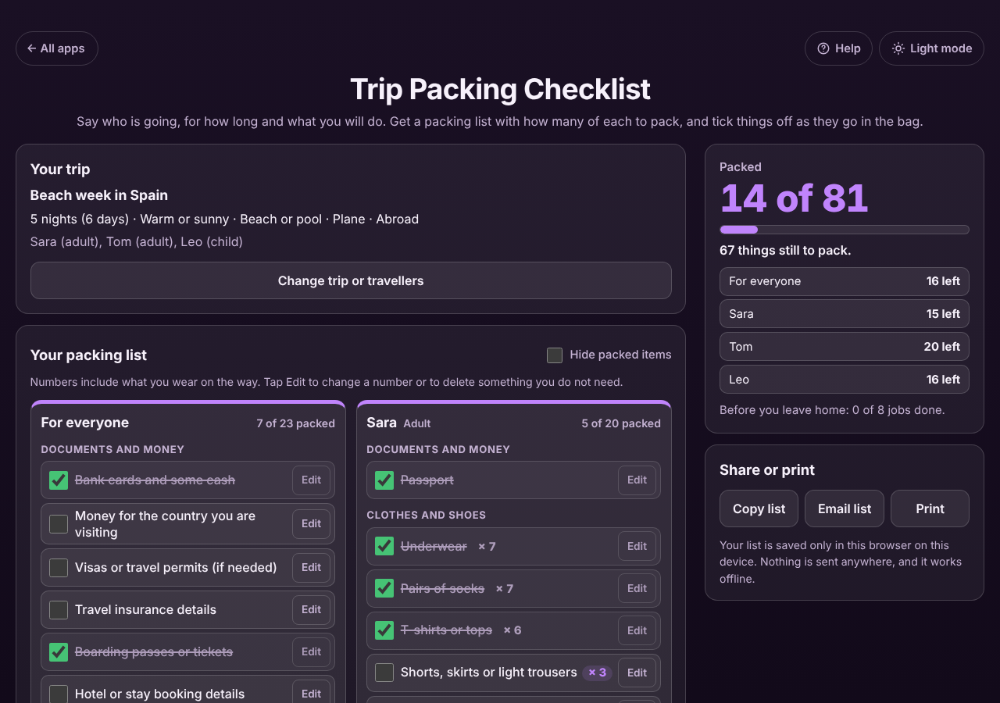

# Trip Packing Checklist

A free **packing list maker for trips and family holidays**. Say who is going (adults, children, babies), how many nights, the weather and plans, and how you are getting there. You get a checklist with **how many of each to pack**, one list per person plus a shared list, and you tick things off as they go in the bag. Change the trip later and your ticks and edits are kept. Works offline, no sign-up, no ads, and the list stays on your device.

**Live demo:** [umar8092.github.io/apps/trip-packing-checklist](https://umar8092.github.io/apps/trip-packing-checklist/)

| Desktop | On a phone |
|---|---|
|  |  |

## The situation it solves

Sara is flying abroad with her partner Tom and their son Leo for a 5-night beach holiday. She always forgets something, and she never knows how many T-shirts to pack for a child. She fills in three travellers, 5 nights, *Warm or sunny*, *Beach or pool*, *Plane* and *Going to another country*, and taps **Make my packing list**. The app answers:

- **5 nights is 6 days away**, counting the day you leave and the day you come back.
- **Sara and Tom:** Underwear × 7 and socks × 7 (one spare), T-shirts or tops × 6, shorts or skirts × 3, swimwear × 2, a passport each, sun hat, sunglasses, sandals, phone and charger.
- **Leo (child):** T-shirts × 7 and shorts × 4 (one extra for spills), books or toys for the journey, his cuddly toy.
- **For everyone:** bank cards, money for the country, travel insurance, boarding passes, sunscreen, after-sun, insect repellent, children's fever medicine, **2 plug adapters**, power bank.
- **Before you leave home:** check in online, take out the rubbish, empty the fridge, water the plants, lock up.
- The Packed box says **14 of 81** and how many things each person still needs, then **Everything is packed. Have a good trip!**

More worked answers:

- **14 nights, no washing:** 16 underwear, 15 tops, 8 trousers, 2 pyjamas. Tick *I can wash clothes there* and it packs for one week: 8 underwear, 7 tops, 4 trousers, 1 pyjamas.
- **A baby for 3 nights by car:** nappies × 24 (6 a day for 4 days), 2 packs of wipes, 8 bodysuits, 4 sleepsuits, travel cot, baby car seat.
- **Day trip by car:** no underwear or pyjamas; walking shoes, a jumper, driving licence, car keys, car charger, and a spare set of clothes for a child.
- **Plans change** (the trip goes from 5 to 6 nights): tops become × 7, and because Sara had already ticked her 6 tops, the item is unticked so she packs the extra one. Everything else she ticked stays ticked.

## Features

- **Help button.** Tap **Help** at the top for a short how-to written for this app, and tap **All apps** to go back to the list.
- **Each traveller has their own list.** Up to 8 people, each an adult, child or baby, each in their own box. Shared things go in **For everyone**.
- **How many of each.** Clothes, nappies, wipes, swimwear, jumpers and more are counted from the days away, with a spare where it helps. Numbers include what you wear on the way.
- **Weather and plans.** Warm, cold, rain, beach, hiking and work each add the right things. Plane, car or train add tickets, ID, car seats or a hand-luggage liquids bag.
- **Tick as you pack.** The Packed box shows the total, what each person still needs and the jobs before you leave home. **Hide packed items** shows only what is left.
- **Edit anything.** Change an item's name or number, or delete it (with **Undo**). Add your own items for one person or everyone, and tick **Add it to every trip I make** for things you always take.
- **Change the trip any time.** Your ticks, edits, deletions and own items are kept, and items that now need more are unticked.
- **The way home and the next trip.** **Untick everything** to pack for the way home. **Start a new trip** keeps your travellers and every-trip items. Both can be undone.
- **Share or print.** Copy the list as text with [x] and [ ], email it (no address needed), or print a paper checklist.
- **Private.** Everything stays in this browser on this device. Your data is never sent anywhere.
- **Works offline and installable.** Phone friendly, with a two-column layout on laptops.
- **Back to all apps.** A "← All apps" button at the top of the page.
- **Light and dark mode switch.** It follows your device until you choose, and remembers your choice in every app.

## Run it yourself

No build step and no dependencies.

```bash
git clone https://github.com/umar8092/apps.git
```

Then open `trip-packing-checklist/index.html` in your browser.

Offline mode and install need the files served over `https` or `localhost` (for example `python3 -m http.server`).

## How it works

- `core.js` holds the packing rules, with no page code. `generate()` builds the list from the trip and travellers; `rebuild()` keeps ticks, edits, deletions and own items when the trip changes. All numbers are whole numbers.
- `script.js` builds the page. Everything you type is added as plain text, never as HTML.
- `sw.js` saves the app on your device for offline use (network first, so updates show straight away).
- Run the checks with `node tests.js` (or open `test.html`), and the full page test with `node ui-test.js`.

## License

[MIT](LICENSE). Free to use, copy, modify and share. Made by [Muhammad Umar](https://github.com/umar8092).
