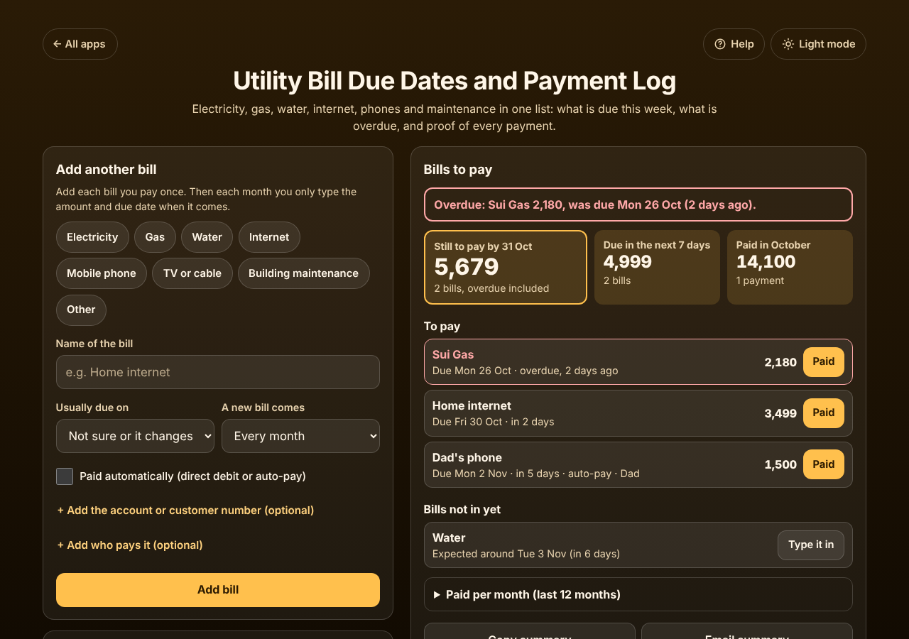
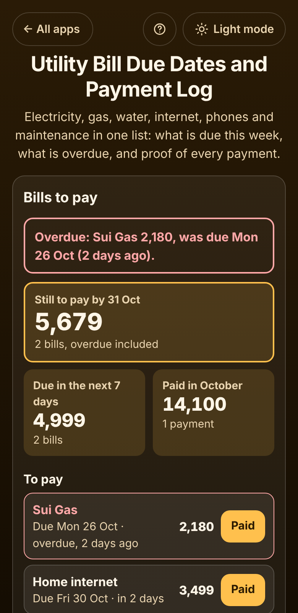

# Utility Bill Due Dates and Payment Log

A free **tracker for household bills**: electricity, gas, water, internet, each mobile phone, TV or cable and the building maintenance. Add each bill once; when a bill comes, type the amount and due date (or tap **Same as last bill**). The app shows which bills are **overdue**, what is **due in the next 7 days**, what is **still to pay by the end of the month**, and which bills have not come in yet. Tap **Paid** with the date, how you paid and the reference number, so you can prove a bill was paid. Each bill is compared with the same month last year to spot a jump. No sign-up, no ads, no connection to your bank or provider, and it works offline.

**Live app:** [umar8092.github.io/apps/utility-bill-due-dates-and-payment-log](https://umar8092.github.io/apps/utility-bill-due-dates-and-payment-log/)

| Desktop | On a phone |
|---|---|
|  |  |

## The situation it solves

Ayesha runs a household in Karachi with five bills a month, each with its own due date: **K-Electric** (due around the 24th), **Sui Gas** (26th), **home internet** (30th), **her dad's phone** (paid automatically on the 2nd) and **water** (3rd). The bills come by SMS, email and paper. Last month she paid a late fee because one was forgotten, and when the electricity company said a bill was unpaid she could not find the receipt.

On Wednesday 28 October 2026 she opens the app and sees:

- **Overdue: Sui Gas 2,180, was due Mon 26 Oct (2 days ago).** In red at the top.
- **Still to pay by 31 Oct: 5,679** (2 bills, overdue included: gas 2,180 + internet 3,499).
- **Due in the next 7 days: 4,999** (internet 3,499 on Fri 30 Oct + phone 1,500 on Mon 2 Nov, which is paid automatically).
- **Paid in October: 14,100** (K-Electric, paid Fri 23 Oct by bank app, **ref TXN 48120931**).
- **Bills not in yet: Water, expected around Tue 3 Nov (in 6 days).**
- K-Electric's box: **8% higher than the last bill (13,000)**. Once she has a year of bills it says, for example, **41% higher than Oct 2025 (10,000)**, so summer is compared with summer.

She pays 1,000 of the gas bill from her mobile wallet: the box shows **1,180 still to pay**. When the rest is paid it turns green. A bill with a **"payable after due date"** amount (for example 1,200, or 1,320 after the due date) asks for **1,320** once the due date has passed without it being paid. A week later the phone bill is not shown as overdue; it says **Check that Dad's phone 1,500 was taken by auto-pay on Mon 2 Nov**, and **It was taken** marks it paid.

## Features

- **Help button.** Tap **Help** at the top for a how-to written for this app, and **← All apps** to go back to the list.
- **Each bill in its own box** with its usual due day, how often it comes (every month, 2, 3 or 6 months, or once a year), optional account number, who pays it and auto-pay.
- **Type in the new bill** in seconds: the due date is filled in from the last bill or the usual day, **Same as last bill** fills the amount, and an optional **amount after the due date**.
- **Paid** with the amount (part payments allowed), the date, how you paid and an optional **reference or receipt number**. Old bills can be typed in already paid.
- **Bills to pay:** overdue bills, due today, auto-pay bills to check, **still to pay by the end of the month**, **due in the next 7 days**, **paid this month**, the **To pay** list by due date, **bills not in yet** and **paid per month** for the last 12 months.
- **Spot a jump:** each bill compared with the same month last year (or the bill before), plus the total and average of the last 12 bills.
- **Past bills** with what was paid, when, how and the reference. **Edit** a bill, remove a payment or delete a bill.
- **Copy summary**, **Email summary** (opens your mail app, no address needed) and **Add due dates to calendar** (a calendar file with a reminder 2 days before each bill).
- **Stop this bill** for a closed account (history kept, can be started again), **Delete**, and **Undo** after every change.
- **Currency symbol** of your choice (or none), remembered.
- **Backup file** to move to another phone, and **Delete everything**.
- **Private.** Everything stays in your browser. It never connects to your bank or provider, and your data is never sent anywhere.
- **Works offline and installable.** Light and dark mode switch next to the back button, remembered across all apps. Laptop layout with the form on the left and your bills on the right.

## Run it yourself

No build step and no dependencies.

```bash
git clone https://github.com/umar8092/apps.git
```

Then open `utility-bill-due-dates-and-payment-log/index.html` in your browser.

Offline mode and install need the files served over `https` or `localhost` (for example `python3 -m http.server`).

## How it works

- `core.js` is the maths and the words, with no page code. Money is whole cents and dates are whole days, so totals are exact. `entryState()` works out one bill (paid, part paid, overdue, the late amount), `nextDue()` the next expected due date, `compare()` the change against last year, `summary()` adds up all bills, and `ics()` writes the calendar file.
- `script.js` builds the page. Names are added as plain text, never as HTML. Bills are saved in this browser's storage under `utility-bill-due-dates-and-payment-log.state`.
- `sw.js` saves the app on your device for offline use (network first, so updates show at once).
- Run the logic checks with `node tests.js` (or open `test.html`), and the page checks with `node utility-bill-due-dates-and-payment-log/ui-test.js` from the repo root while `python3 -m http.server 8765` runs there.

## License

[MIT](LICENSE). Free to use, copy, modify and share. Made by [Muhammad Umar](https://github.com/umar8092).
