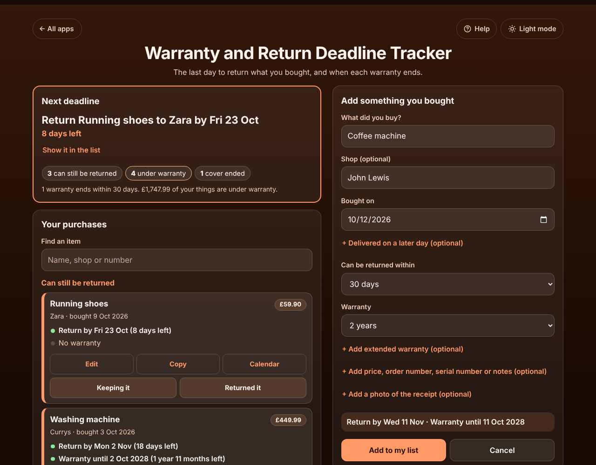

# Warranty and Return Deadline Tracker

A free **warranty and return deadline tracker** for everything you buy. Add what you bought, the shop, the day you bought it (or the day it was delivered), how long you have to return it and how long the warranty lasts, and the app shows **the last day to return it** and **the day the warranty ends**, most urgent first. Keep a photo of the receipt on your phone, add the deadlines to your calendar with reminders, and copy all the details when something breaks and you need to claim. Works offline, no sign-up, no ads.

**Live demo:** [umar8092.github.io/apps/warranty-and-return-deadline-tracker](https://umar8092.github.io/apps/warranty-and-return-deadline-tracker/)

| Desktop | On a phone |
|---|---|
|  |  |

## The situation it solves

Sara bought a washing machine from Currys on Saturday 3 October 2026 for 449.99, with 30 days to return it and a 2-year warranty. On 9 October she bought running shoes from Zara with 14 days to return them, and on 10 October she ordered a phone from amazon.com that arrived on 14 October (28 days to return, 1-year warranty, plus 2 more years of extended warranty). She keeps forgetting return windows, and when something breaks she can never find the receipt.

On Thursday 15 October the app answers:

- **Next deadline:** Return Running shoes to Zara by **Fri 23 Oct**, **8 days left**.
- **Washing machine:** Return by **Mon 2 Nov** (18 days left). Warranty until **2 Oct 2028** (1 year 11 months left).
- **Phone:** counted from delivery, Return by **Wed 11 Nov** (27 days left). Warranty until **13 Oct 2027**, Extended warranty until **13 Oct 2029**.

She decides to keep the washer and taps **Keeping it**, so it moves to "Under warranty" and its return countdown stops. A year later the washer leaks: she searches for "washing", taps **Copy** and pastes the shop, date, price, order and serial number and "Warranty until 2 Oct 2028" into her claim email, then taps **Receipt** to show the photo.

How the dates are counted: "30 days to return" from 3 Oct ends on 2 Nov (the day plus 30 days). A warranty ends on the day before the same date at the end of the period (2 years from 3 Oct 2026 ends 2 Oct 2028). When that date does not exist, the last day of the month is used: 1 month from 31 Jan ends 28 Feb, and 1 year from 29 Feb 2024 ends 28 Feb 2025.

## Features

- **Help button.** Tap **Help** at the top for a short how-to written for this app, and tap **All apps** to go back to the list.
- **Next deadline** at the top, with the days left and counts of what can still be returned, what is under warranty and what has no cover left.
- **Each purchase in its own box**, sorted into **Can still be returned** (closest deadline first), **Under warranty** (the warranty that ends first at the top, lifetime last) and **Cover ended**. Orange means a return closes within 7 days or a warranty ends within 30 days.
- **Return windows:** 7, 14, 28, 30, 60 or 90 days, any number from 1 to 365, **Until a date** (Christmas returns) or **No returns**.
- **Warranties:** 3 or 6 months, 1, 2, 3 or 5 years, **Lifetime**, any length in months or years (up to 50 years), **Until a date** or **No warranty**.
- **Delivered on a later day (optional)** for online orders, so the days count from delivery. **Extended warranty (optional)** that starts when the maker's warranty ends.
- **Price, order number, serial number and notes (optional)**, and a **receipt photo or PDF (optional)** kept on the device. Photos are made smaller to save space.
- A **preview line** shows the last return day and the warranty end before you save.
- **Keeping it**, **Returned it**, **No longer have it** and **Put back**, all with **Undo**. **Edit** fixes a mistake, **Delete this item** with Undo.
- **Calendar** on each item, and **Add all deadlines to my calendar**: a calendar file with all-day events and reminders 3 days and 1 day before a return deadline, and 30 and 7 days before a warranty ends.
- **Copy** an item for a claim, **Copy the list** and **Email the list** (email works without typing an address first).
- **Find an item** by name, shop, order or serial number once you have 6 or more.
- **Currency symbol** for prices (none, $, €, £, ₹, Rs and more), remembered.
- **Save a backup file** (with the receipts) and **Restore a backup**, **Delete everything** with Undo. Damaged or blocked saved data is handled with a clear message.
- **Private.** Your purchases and receipts stay in this browser on this device; your data is never sent anywhere.
- **Works offline and installable.** The days left update by themselves every day.
- **Back to all apps.** A "← All apps" button at the top of the page.
- **Light and dark mode switch.** It follows your device until you choose, and remembers your choice in every app.

## Run it yourself

No build step and no dependencies.

```bash
git clone https://github.com/umar8092/apps.git
```

Then open `warranty-and-return-deadline-tracker/index.html` in your browser.

Offline mode, install and receipt photos work best with the files served over `https` or `localhost` (for example `python3 -m http.server`).

## How it works

- `core.js` is the logic, with no page code. Dates are calendar dates (`2026-10-03`), so time zones and summer time never move a deadline. Prices are whole cents. It works out the last return day, the warranty and extended warranty ends, sorts the list, writes the copy text and the calendar file, reads the form with plain error messages, and checks every saved or restored value.
- `script.js` builds the page. Names and notes are added as plain text, never as HTML. The list is saved in `localStorage`; receipt photos are saved in IndexedDB on the device.
- `sw.js` saves the app on your device for offline use (network first, so updates show at once).
- Run the logic checks with `node tests.js` (or open `test.html`), and the full page test with `node ui-test.js` (needs Playwright). The page test fixes "today" to 15 Oct 2026 and checks the exact answers above.

## License

[MIT](LICENSE). Free to use, copy, modify and share. Made by [Muhammad Umar](https://github.com/umar8092).
