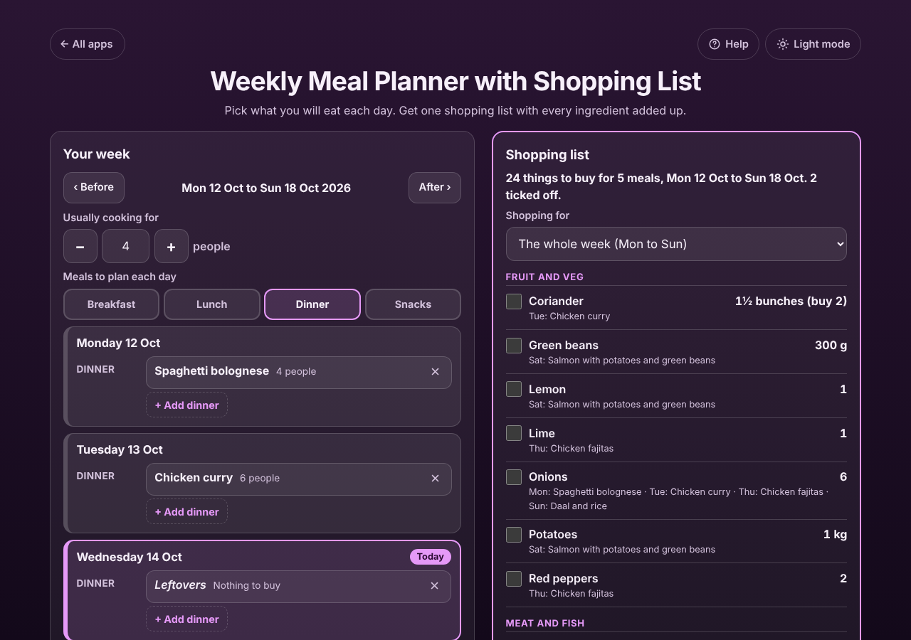

# Weekly Meal Planner with Shopping List

A free **weekly meal planner that writes your shopping list for you**. Pick what you will eat on each day of the week and for how many people, and get one shopping list with every ingredient added up and sorted by aisle: 1 onion on Monday and 2 onions for 6 people on Tuesday become **Onions: 4**. Tick things off in the shop, copy or email the list to whoever is shopping, and print the week for the fridge. Works offline, no sign-up, no ads.

**Live demo:** [umar8092.github.io/apps/weekly-meal-planner-with-shopping-list](https://umar8092.github.io/apps/weekly-meal-planner-with-shopping-list/)

| Desktop | On a phone |
|---|---|
|  |  |

## The situation it solves

Sara does the big shop on Monday morning for a family of 4. On Sunday night she decides the dinners: Spaghetti bolognese on Monday, Chicken curry on Tuesday (her brother and his wife come, so 6 people), leftovers on Wednesday, Chicken fajitas on Thursday, eating out on Friday, Salmon with potatoes on Saturday and Daal and rice on Sunday. She needs to know **exactly what to buy, once, for the whole week**.

The app answers:

- **Onions: 6** (1 for the bolognese + 2 × 6/4 = 3 for the curry for 6 + 1 for the fajitas + 1 for the daal), with *Mon: Spaghetti bolognese · Tue: Chicken curry · Thu: Chicken fajitas · Sun: Daal and rice* underneath.
- **Garlic: 8½ cloves (buy 9)** (2 + 4½ + 2).
- **Basmati rice: 750 g** (450 g for the curry for 6 + 300 g for the daal).
- **Tomatoes: 2 tins**, **Coconut milk: 1½ tins (buy 2)**, **Chicken thighs: 900 g**.
- "25 things to buy for 5 meals, Mon 12 Oct to Sun 18 Oct". Leftovers and eating out add nothing.

In the shop she ticks items off; they move to **Got it**. On Wednesday her husband can choose **Shopping for: Today to Sun** and get only what the rest of the week still needs.

## Features

- **Help button.** Tap **Help** at the top for a short how-to written for this app, and tap **All apps** to go back to the list.
- **Your week.** Seven days, each in its own box, with today marked. **Before** and **After** change week. Plan breakfast, lunch, dinner and snacks, or only the meal times you want.
- **Each meal its own number of people.** "Usually cooking for 4", but Sunday lunch for 8 gets twice the ingredients. The app says "The list uses 1½ times every ingredient".
- **Leftovers, Eating out or Something else** (such as "Takeaway pizza") on days you do not cook; nothing goes on the list for them.
- **A new meal straight from the day**, or **My meals** with name, how many portions the recipe makes and the ingredients, one per line. Paste a recipe's list: bullets, headings like "For the sauce:", sizes in brackets and words like "chopped" are understood. **Goes on the shopping list as** shows how each line is read before you save. **Add 7 example meals** to start.
- **One shopping list, added up exactly.** Grams with kilograms, ml with litres, teaspoons with tablespoons and cups, "2 x 400 g tins" as 800 g, ranges like "2-3 carrots" as 3. Units that cannot be added exactly stay side by side ("300 ml + 1 cup"); pounds and grams are added as "about". Halves show as ½ with "buy 2". Sorted by aisle, with which meals need each item.
- **Tick off at home and in the shop**, **Untick everything**, **Add something else to buy** (also a pasted list), **Copy**, **Share**, **Email** (works with no address typed) and **Print the week and list**.
- **Change, move and remove.** Tap a meal to change it, its number of people, or move it to another day or meal time. Remove with **Undo**. **Copy last week's meals** and **Clear this week**, both with Undo.
- **My week starts on** any day, so the week runs from your shopping day.
- **Backup file and restore**, **Delete everything** with Undo. Saved data that is damaged or blocked is handled with a clear message.
- **Private.** Your meals and lists stay in this browser on this device; your data is never sent anywhere.
- **Works offline and installable**, so the list works in a shop with no signal.
- **Back to all apps.** A "← All apps" button at the top of the page.
- **Light and dark mode switch.** It follows your device until you choose, and remembers your choice in every app.

## Run it yourself

No build step and no dependencies.

```bash
git clone https://github.com/umar8092/apps.git
```

Then open `weekly-meal-planner-with-shopping-list/index.html` in your browser.

Offline mode and install need the files served over `https` or `localhost` (for example `python3 -m http.server`).

## How it works

- `core.js` is the logic, with no page code. Each ingredient line is read into an amount, a unit and a name. Amounts are kept as exact fractions while they are scaled (people ÷ portions) and added up, and are rounded only when shown. Names are matched without size and preparation words and with plurals made singular, so "2 large onions, chopped" and "1 onion" are the same thing. Days are calendar dates, so time zones and summer time never move a meal.
- `script.js` builds the page. Meal names and ingredients are added as plain text, never as HTML.
- `sw.js` saves the app on your device for offline use (network first, so updates show at once).
- Run the logic checks with `node tests.js` (or open `test.html`), and the full page test with `node ui-test.js` (needs Playwright).

## License

[MIT](LICENSE). Free to use, copy, modify and share. Made by [Muhammad Umar](https://github.com/umar8092).
