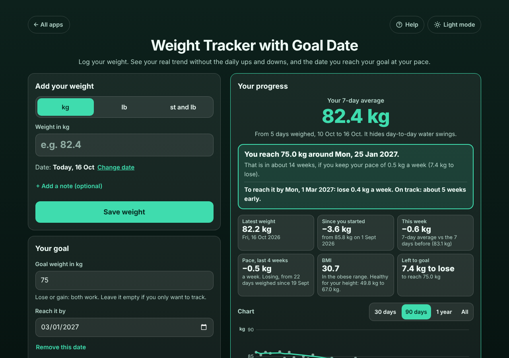

# Weight Tracker with Goal Date

A free **weight tracker for anyone losing (or gaining) weight** who wants to know if it is really working and **when they will reach their goal**. Log your weight in kg, lb or stone and lb. The app shows your **7-day average**, which hides the daily water swings that make the scale so discouraging, the change this week and since you started, your **pace over the last 4 weeks**, your BMI and a chart, and answers the question in plain words: *"You reach 75.0 kg around Mon, 25 Jan 2027."* Add a date you want to reach it by and it tells you the weekly change you need and whether you are early or late. No sign-up, no ads, private on your device, works offline.

**Live demo:** [umar8092.github.io/apps/weight-tracker-with-goal-date](https://umar8092.github.io/apps/weight-tracker-with-goal-date/)

| Desktop | On a phone |
|---|---|
|  |  |

## The situation it solves

Ayesha (164 cm) starts at **85.8 kg** on 1 September. Her doctor suggests getting to **75 kg**, and she would like to be there by her sister's wedding on **1 March 2027**. She weighs herself most mornings, but the scale jumps up and down by a kilo from one day to the next, so some mornings it looks like nothing is working. What she wants to know is: *am I really losing, how fast, and when do I get there?*

She types her weight each morning and taps **Save weight**. On 16 October the app answers:

- **Your 7-day average: 82.4 kg** (from 5 days weighed, 10 to 16 Oct). It hides the day-to-day water swings.
- **You reach 75.0 kg around Mon, 25 Jan 2027.** That is in about 14 weeks, if she keeps her pace of 0.5 kg a week (7.4 kg to lose).
- **To reach it by Mon, 1 Mar 2027: lose 0.4 kg a week. On track: about 5 weeks early.**
- Latest weight 82.2 kg, since she started **−3.6 kg**, this week **−0.6 kg**, pace **−0.5 kg a week**, BMI **30.7** with the healthy range for her height (49.8 to 67.0 kg).

Worked examples from the tests (all checked by hand or separately in Python):

- One weigh-in a week, 84.0, 83.5, 83.0, 82.5 kg: pace exactly **0.5 kg a week**; 7.5 kg to go at 0.5/7 kg a day is **105 days**, so from 16 Oct 2026 the goal date is **29 Jan 2027**. To reach it by 1 Mar 2027 (136 days) needs 7.5 / 136 × 7 = **0.39 kg a week**, and 29 Jan is **31 days early**.
- Ayesha's log: the 5 days weighed in the last 7 (83.1, 81.9, 83.0, 82.0, 82.2) average **82.44 kg**; the best straight line through the last 4 weeks falls **518.6 g a week**; 7.44 kg / 74.09 g a day = 100.4, so **101 days** to 25 Jan 2027.
- Two weigh-ins on one day (80.0 and 80.5) are both kept; the day counts as **80.25 kg**.
- 82.4 kg is **181.7 lb** and **12 st 13.7 lb**; 181.96 lb shows as **13 st 0.0 lb**, never "12 st 14.0 lb".
- BMI at 164 cm: 82.44 / 1.64² = **30.65 → 30.7**.
- Typing 824 says *"Type a weight from 20 to 350 kg. Did you mean 82.4?"*; 95 kg two days after 85 kg asks *"Please check it; if it was a typo, tap Undo."*

When no date can be honest, the app says why instead of guessing: too few weigh-ins (needs 3 in the last 4 weeks spread over a week), weight hardly changing, weight moving away from the goal, or more than 5 years away at this pace.

## Features

- **Help button** at the top with a how-to for this app, **All apps** to go back to the list, and a **Light / Dark** switch.
- **kg, lb or st and lb**, switch at any time: weights are stored exactly, so nothing changes. "82,4", "181 lb", "12 st 6" are understood. UK English starts in stone, US English in pounds.
- **7-day average** that hides daily water swings, **latest weight**, **since you started**, **this week** (7-day average against the 7 days before) and **pace over the last 4 weeks** (least-squares line).
- **Goal date** at your real pace, for losing or gaining, with plain reasons when there is no date; optional **reach it by** date with the weekly change you need and early or late.
- **BMI** (optional height in cm or ft and in) with the healthy weight range for your height; hide the ranges for children, pregnancy or very muscular people. A gentle note if you lose more than 1% of your weight a week.
- **Chart** of each day's weight, the 7-day average line and your goal, for 30 days, 90 days, 1 year or all.
- **Change date** to log a day you forgot (future dates refused), optional notes, two weigh-ins a day kept and averaged, typo warnings for big jumps.
- **Your weights** list, each in its own box with the change from the day before; **Edit** (Escape cancels) and **Delete** with **Undo**.
- **Copy as text**, **Email** (no address needed), **Print or save as PDF**, **Download spreadsheet** (CSV in kg and lb).
- **More than one person** on one device, each with their own weights, unit, goal and height.
- **Backup file** and **Restore** (checked, with Undo), **Delete all weights** with Undo.
- Private: no account and your data is never sent anywhere. Works offline once loaded, and can be installed on the home screen.

Not medical advice: follow your doctor's advice, especially in pregnancy, illness or for children.

## Run it yourself

```
git clone https://github.com/umar8092/apps.git
```

Then open `weight-tracker-with-goal-date/index.html` in a browser. No build step and no dependencies.

Tests: `node weight-tracker-with-goal-date/tests.js` checks the maths (or open `test.html`), and `node weight-tracker-with-goal-date/ui-test.js` drives the page in headless Chromium (needs Playwright).

## How it works

Plain HTML, CSS and JavaScript. The maths lives in `core.js`. Every weight is stored as whole grams, so switching between kg, lb (1 lb = 453.59237 g) and stone never changes a saved value. Each day counts once, as the average of that day's weigh-ins. The 7-day average is the mean of the days weighed in the 7 days ending on the latest weigh-in. The pace is the slope of the least-squares line through the daily values of the last 28 days; the goal date is the number of days that slope needs to take the 7-day average to the goal, rounded up. Dates are counted as calendar days, so time zones and summer time never move a weigh-in. Everything is saved in this browser's `localStorage`; a network-first service worker keeps the app working offline.

## License

MIT, see [LICENSE](LICENSE).
