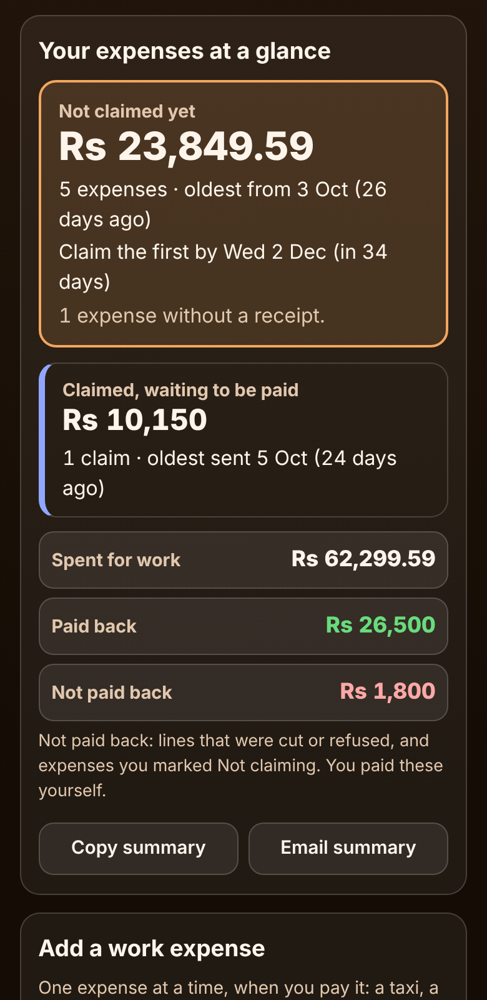

# Work Expense Claim Log for Employees

A free log for **employees who pay for work things out of their own pocket and claim the money back**: office workers, sales reps, field engineers and anyone who travels for work. Add each taxi, client lunch, hotel night, flight, mileage trip or office purchase when you pay it, tick the ones you are claiming, copy a ready-made list for the claim form, and the app answers in plain words: **"Not claimed yet: 23,849.59, 5 expenses, oldest from 3 Oct (26 days ago)"**, **"Claimed, waiting to be paid: 10,150, sent 5 Oct (24 days ago)"** and **"Paid back 26,500 of 28,300 on 20 Oct, 1,800 not paid back"**. Amounts paid in another currency or worked out from a distance are converted to the cent. No sign-up, no ads, private on your device, works offline.

**Live demo:** [umar8092.github.io/apps/work-expense-claim-log-for-employees](https://umar8092.github.io/apps/work-expense-claim-log-for-employees/)

| Desktop | On a phone |
|---|---|
| ![Work Expense Claim Log on a laptop: the Add a work expense form on the left with Paid in another currency and Work it out from distance links, client chips Habib Foods and Lahore trade fair, and the No receipt tick box; on the right Your expenses at a glance says Not claimed yet Rs 23,849.59, 5 expenses, oldest from 3 Oct (26 days ago), claim the first by Wed 2 Dec, 1 expense without a receipt, Rs 10,150 claimed and waiting since 5 Oct, spent for work Rs 62,299.59, paid back Rs 26,500 and not paid back Rs 1,800](screenshots/desktop.png) |  |

## The situation it solves

Ayesha is a sales executive in Karachi. She pays for taxis to clients, client lunches, parking, a flight and hotel for a trade fair, printer ink, and drives her own car to a factory. Her company, Orion Traders, pays it all back, but only for expenses **claimed within 60 days**, and only after she fills in a claim form. Receipts end up in her bag, a lunch is forgotten, a claim sits unpaid for weeks, and when the hotel was paid back only up to the limit she never noticed. It is Thursday 29 October.

She set **Your company's claim rules** once (Orion Traders, claim within 60 days) and added her expenses:

- **September:** flight to Lahore **18,500** and hotel **9,800** (claimed 30 Sep as EXP-0398, paid back on 20 Oct, but the hotel only up to **8,000**); Careem to Habib Foods **1,250**, lunch with Habib Foods buyers **8,600** and parking **300** (claimed together on 5 Oct, not paid yet).
- **October, not claimed yet:** Uber to Habib Foods **1,450** (3 Oct), printer ink **4,200** with no receipt (9 Oct), her own car to the Hub factory **120 km at 65 = 7,800** (14 Oct), dinner with Habib Foods **5,900** (21 Oct), and Zoom Pro for a webinar paid in dollars, **USD 15.99 at 281.4 = 4,499.59** (26 Oct).

The app now says:

- **Not claimed yet: Rs 23,849.59.** 5 expenses · oldest from 3 Oct (26 days ago) · claim the first by **Wed 2 Dec (in 34 days)** · 1 expense without a receipt.
- **Claimed, waiting to be paid: Rs 10,150.** 1 claim · oldest sent 5 Oct (24 days ago).
- **Spent for work Rs 62,299.59 · Paid back Rs 26,500 · Not paid back Rs 1,800** (the hotel cut).
- **Month by month, October:** Rs 23,849.59 · by type: fuel or mileage 7,800, client meals 5,900, phone or internet 4,499.59, office supplies 4,200, taxis 1,450 · by client: **Habib Foods 15,150**, no client 8,699.59.

So she taps **Tick all 5 for one claim**, **Copy list for the claim form**, pastes it into the finance email, and taps **Mark as claimed**.

Worked examples from the tests (all checked by hand):

- **USD 15.99 at 281.4** = 4,499.586 → **4,499.59** (rounded to the nearest cent, half up). **AED 45 at 76.2 = 3,429**. **EUR 10 at 310.25 = 3,102.50**.
- **120 km at 65 = 7,800**; **120.5 km at 0.45** = 54.225 → **54.23**; **37.3 miles at 0.70 = 26.11**.
- Claim-by dates: 3 Oct + 60 days = **2 Dec**, 34 days after 29 Oct. With a 30-day rule it is **2 Nov (in 4 days, Claim soon)**; with 20 days it was **23 Oct, 6 days late**, shown in red.
- The four totals always add up: spent 62,299.59 = paid back 26,500 + waiting 10,150 + not claimed yet 23,849.59 + not paid back 1,800.
- **Claim the cut part again** after the hotel was paid 8,000 of 9,800 puts **1,800 still to claim of 9,800 (8,000 paid back)** back in the list.
- A claim of 4,000 out of a 5,900 dinner leaves **1,900 still to claim of 5,900 (4,000 waiting)**. Claiming more than is left, a payment larger than the line claimed, a claim dated before the expense, or lowering an expense below what is already claimed are all refused with a clear message.
- Amounts can be typed as `1450`, `1,350.50`, `Rs 1350.5`, `35 000`, `1,00,000` or `2500/-`. Blank, 0, a minus sign, words, 3 decimals, a future date or a huge amount each get a clear message.

## Features

- **Help button** at the top with a how-to for this app, **All apps** to go back to the list, and a **Light / Dark** switch.
- **Add a work expense**: date, amount, **Type of expense** (taxi or ride, fuel or mileage, train/bus/flight, hotel, meals, client meal or entertainment, office supplies, phone or internet, daily allowance, parking or tolls, other), **What was it for?**, an optional **client or project** (tap one used before), **I have no receipt for this**, and **+ Add a note (optional)**. The date, type and client stay filled in, so a whole trip is quick to enter.
- **+ Paid in another currency**: currency code, amount and rate; the amount in your money is worked out to the cent and the list shows both.
- **+ Work it out from distance (mileage)**: distance in km or miles and the rate your company pays.
- **Your company's claim rules**: an optional company name for the copied list and **Claim within** (no limit, 30, 60, 90, 180 days, 1 year or any number). Each expense then shows **Claim by**, turns orange 14 days before and red after.
- **Your expenses at a glance**: not claimed yet with the oldest expense and the first claim-by date, expenses past the limit or due soon, how many have no receipt, claims waiting and for how long (a reminder to ask finance after 30 days), and spent / paid back / not paid back. **Copy summary** and **Email summary** (works with no recipient typed).
- **Not claimed yet / All expenses** tabs, each expense in its own bordered box with **Edit**, **Not claiming** (for a personal or private part) and **Delete**.
- **New claim**: tick expenses or **Tick all for one claim**, lower the amount for any line, **Copy list for the claim form** (every line, totals by type and the grand total), the date sent and an optional claim number, then **Mark as claimed**.
- **Paid back**: each line starts at what you claimed; lower a cut line or type 0 for a refused one, and the claim shows what was not paid back. **Claim the cut part again**, **Rejected** with a reason (its expenses go back to the list), **Edit claim**, **Delete claim** and **Mark as waiting again**.
- **Month by month**: each month's total, paid back, waiting and not claimed yet, by type and by client or project, with **Copy this month**.
- **Undo** after every change, **Currency symbol** (none, Rs, ₹, $, €, £, AED, SAR and more, remembered), **Save the list as a spreadsheet (CSV)**, **Save a backup file**, **Restore a backup**, **Delete everything**.
- Installable, works offline, and your data is never sent anywhere.

## Run it yourself

```
git clone https://github.com/umar8092/apps.git
```

Then open `work-expense-claim-log-for-employees/index.html` in a browser. To test: `node work-expense-claim-log-for-employees/tests.js` (logic) and, with `python3 -m http.server 8765` running in the repo root, `node work-expense-claim-log-for-employees/ui-test.js` (the page, in headless Chromium).

## How it works

Plain HTML, CSS and JavaScript with no libraries. `core.js` holds the maths: money is kept in whole cents, exchange rates in millionths and distances in tenths, and conversions are done with whole numbers (BigInt) and rounded half up, so every total is exact. An expense is **not claimed yet** until claims cover its amount; a rejected claim gives its expenses back; a paid claim keeps what was paid for each line. Everything is saved in your browser's local storage under keys starting with `work-expense-claim-log-for-employees.`, checked when loaded and when restored. A network-first service worker keeps a copy for offline use.

## License

MIT, see [LICENSE](LICENSE).
