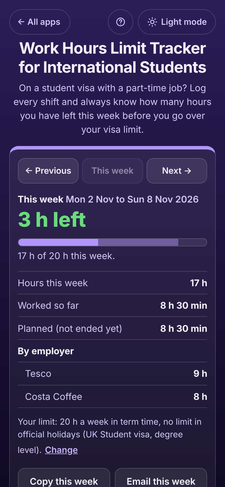

# Work Hours Limit Tracker for International Students

A free **shift log for international students with a part-time job** who must stay under their visa's work limit: 20 hours a week in term time for UK degree students, 48 hours a fortnight in Australia, 24 hours a week off campus in Canada, 20 in Ireland and on US campuses, 25 in New Zealand, or your own limit. Add each shift from one or more employers and the app answers the question that matters: **how many hours do I have left this week?** It counts night shifts on the right days, takes off unpaid breaks, treats shifts that have not ended yet as **planned** so you can see before you work them whether they would take you over, and lifts or changes the limit in your official holidays. No sign-up, no ads, private on your device, and it works offline.

**Live app:** [umar8092.github.io/apps/work-hours-limit-tracker-for-international-students](https://umar8092.github.io/apps/work-hours-limit-tracker-for-international-students/)

| Desktop | On a phone |
|---|---|
|  |  |

## The situation it solves

Priya is a master's student in Manchester on a UK Student visa, so she may work **20 hours a week in term time** (a week runs Monday to Sunday, and hours cannot be averaged). She has two jobs whose rotas do not talk to each other: Costa Coffee and Tesco. It is **Thursday 5 November, 13:00**, and Tesco asks if she can do an extra shift on Sunday from 12:00 to 16:00.

Her week in the app:

- Mon 2 Nov, Costa Coffee, 09:00 to 13:00: **4 h** (worked)
- Tue 3 Nov, Tesco, 17:00 to 22:00 with a 30 minute unpaid break: **4 h 30 min** (worked)
- Thu 5 Nov, Costa Coffee, 18:00 to 22:00: **4 h** (planned, it has not ended yet)
- Sat 7 Nov, Tesco night shift 22:00 to 02:30: **4 h 30 min** (planned; it ends on Sunday, still in this week)

The top of the app says **"3 h left"** and **"17 h of 20 h this week"**, with **Worked so far 8 h 30 min**, **Planned 8 h 30 min**, **Tesco 9 h**, **Costa Coffee 8 h**.

Before saying yes to Tesco she types the Sunday shift into **Add a shift**. Without saving, the form already says **"Shift length: 4 h. With it you would be over the limit by 1 h that week."** So she offers 12:00 to 15:00 instead: **"After it you would be exactly at the limit, with no hours left that week."** If she had saved the 4-hour shift, the week would turn red, **"Over by 1 h"**, with the list of planned shifts she could drop or shorten.

Other worked answers:

- **A Sunday night shift** from 22:00 to 04:00 counts **2 h** in this week and **4 h** in next week, exactly as a Monday-to-Sunday week does.
- **Australia, 48 hours a fortnight.** Every 14 days starting on a Monday count, so fortnights overlap. With 24 h last week and 16 h this week, the app shows the fortnight **Mon 26 Oct to Sun 8 Nov: 40 h of 48 h** and the fortnight **Mon 2 Nov to Sun 15 Nov**, and **"8 h left"** from the tighter one.
- **Christmas vacation** (12 Dec to 10 Jan) added under **Official holidays**: a week where every day is in the holiday shows **"No limit this week"** (UK) or a **40 h** limit (Ireland). The week of 7 to 13 December is only partly in the holiday, so the 20 h term-time limit still applies, to keep her safe.

## Features

- **Your visa rule**: UK degree level (20 h a week), UK below degree (10 h), Australia (48 h a fortnight), Canada off campus (24 h), Ireland (20 h, 40 h in holidays), New Zealand (25 h), USA F-1 on campus (20 h), or **My own limit** with any hours, a week or a fortnight, the day weeks start and a holiday limit.
- **Add a shift** with the employer (tap one you used before), the day, start and end, an optional **unpaid break** and an optional note. The form shows the shift length and what the week would be with it, before you save.
- **Night shifts** past midnight are split between the two days, and between two weeks on a Sunday night.
- **Worked and planned**: shifts that have not ended yet count as planned; the bar shows worked hours solid and planned hours lighter.
- **The answer**: hours left, **No hours left**, **Over by ...** with the planned shifts you could drop, or **No limit this week** in a holiday week.
- **Two or more employers**: hours by employer for the week.
- Every shift in its own box with **Edit**, **Same time next week** and **Delete** (with **Undo**). **Previous**, **This week** and **Next** move between weeks; **Every week so far** lists each week with its total and marks any week over the limit.
- **Official holidays**: add your university's vacation dates.
- **Copy this week** and **Email this week** (works with no address typed), **Download all shifts (CSV for Excel)**, **Save a backup file** and **Restore a backup**, **Delete everything** with **Undo**.
- **Help** button in the top bar, **All apps** back button and a **Light / Dark mode** switch. Works on phones, tablets and laptops (side by side on a wide screen), with a keyboard and a screen reader.
- Your data is never sent anywhere: it stays in this browser on this device. Works offline once loaded, and can be installed to the home screen.

The rules built in are the usual ones as of October 2026. They are not legal advice: your own visa, permit or university may say something different, so check your conditions or ask your international student office.

## Run it yourself

```
git clone https://github.com/umar8092/apps.git
```

Then open `work-hours-limit-tracker-for-international-students/index.html` in a browser. Open `test.html` (or run `node tests.js`) to run the logic checks.

## How it works

Plain HTML, CSS and JavaScript, no libraries. All sums are in whole minutes, so totals are exact. Dates are counted as whole days, so summer time never moves a shift to another day. `core.js` holds the rules (weeks, rolling fortnights, holiday weeks, night-shift splitting, planned versus worked) and is tested by `tests.js`; `script.js` draws the page. Shifts are saved in `localStorage` under keys starting with `work-hours-limit-tracker-for-international-students.`, and a network-first service worker keeps a copy for offline use.

## License

MIT, see [LICENSE](LICENSE).
