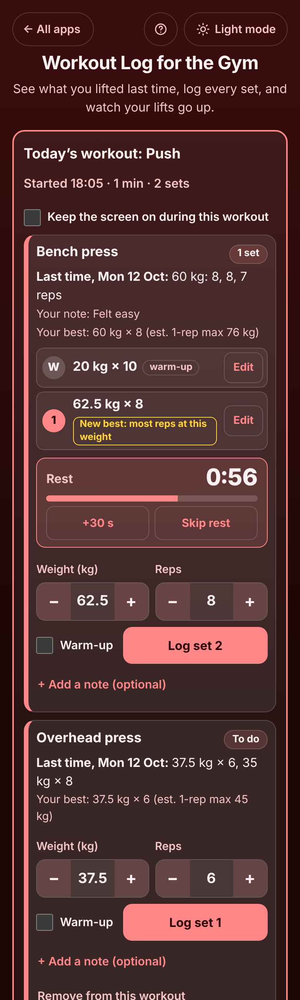

# Workout Log for the Gym

A free **workout log for the gym** that answers the question you ask at every machine: *what did I lift last time?* Start Push, Pull, Legs, Upper and Lower, Full body or your own plan, and every exercise shows the sets from your last workout with the weight and reps already filled in, so logging a set is one tap. A rest timer counts down after each set, a **New best** note appears when you beat yourself, and the finish screen shows how long you trained, your sets, the total weight lifted and your new bests. Works offline (even in a gym basement), no sign-up, no ads.

**Live demo:** [umar8092.github.io/apps/workout-log-for-the-gym](https://umar8092.github.io/apps/workout-log-for-the-gym/)

| Desktop | On a phone |
|---|---|
|  |  |

## The situation it solves

Ali trains Push, Pull, Legs. On Monday 12 October he benched 60 kg for 8, 8 and 7 reps (after a 20 kg warm-up) and wrote "Felt easy". A week earlier he did 65 kg for 5. Standing at the bench on Friday 16 October he can never remember those numbers, so he either repeats the same weight for months or guesses.

He taps **Start Push** at 18:05. The Bench press box says:

- **Last time, Mon 12 Oct: 60 kg: 8, 8, 7 reps** and *Your note: Felt easy*
- **Your best: 60 kg × 8 (est. 1-rep max 76 kg)**
- The boxes already hold **60** and **8**.

He ticks **Warm-up** and logs 20 kg × 10, taps **+** once (60 → 62.5 kg) and logs 62.5 kg × 8. The set gets **New best: most reps at this weight** (his only heavier set, 65 kg, was for 5) and a **1:30** rest timer starts. Later he logs 67.5 kg × 3 (**New best: heaviest ever**), 60 kg × 8, dips for 11 reps, then 6 more with +10 kg, overhead press 37.5 kg × 6 and a 1:15 plank.

At 18:57 he taps **Finish workout**:

- **Push finished: 52 min.** 4 exercises, 8 sets, **1,467.5 kg lifted in total** (62.5×8 + 67.5×3 + 60×8 + 10×6 + 37.5×6; warm-ups and bodyweight do not count).
- **3 new bests:** Bench press 67.5 kg × 3 (heaviest ever), Dips +10 kg × 6 (most extra weight), Plank 1:15 (longest hold).
- **Skipped:** Incline dumbbell press, Lateral raise, Triceps pushdown.

Next week Bench press says *Last time, Fri 16 Oct: 62.5 kg × 8, 67.5 kg × 3, 60 kg × 8*, and Pull is marked **Up next** because it is the plan he did longest ago.

What counts as a new best: a set no earlier set matched, meaning no earlier set was at least as heavy with at least as many reps. The est. 1-rep max uses Epley, weight × (1 + reps ÷ 30), only for 2 to 12 reps: 60 kg × 8 gives 76 kg.

## Features

- **Help button.** Tap **Help** at the top for a short how-to written for this app, and tap **All apps** to go back to the list.
- **Ready-made plans** on the first visit (Push, Pull, Legs; Upper and Lower; Full body), or **make your own**: name, exercises in order (move up and down, remove), and each exercise's own rest time.
- **Three kinds of exercise:** weight and reps (barbell, dumbbell, machine), reps of a bodyweight move with **optional extra weight**, and time held (plank, wall sit) typed as 45 or 1:30.
- **Each exercise in its own box** with **Last time**, your note from last time, **Your best**, the sets logged today, and boxes filled in from last time. **−** and **+** change the weight by 2.5 kg (5 lb) and the reps by 1. Enter logs a set.
- **Warm-up sets** that never count towards bests or the total.
- **Rest timer** after each set: Off, 30 s to 5 min or any number of seconds (5 to 900), as a usual rest or per exercise. **+30 s** and **Skip rest**, a beep and a vibration at the end, the time left in the tab title. It keeps going when the phone locks or the page reloads.
- **New best** notes: heaviest ever, most reps at this weight, most extra weight, most reps, longest hold.
- **Edit** or **Delete** any set, **Remove** an exercise you are not doing, **+ Add an exercise** just for today or also to the plan, a **note** per exercise. Undo on everything.
- **Finish workout** shows the length, sets, total lifted, new bests and what was skipped, with **Copy**, **Share or email** and **Not finished yet**. **Discard workout** with Undo; a workout with no sets is not saved.
- **Forgot to finish?** Hours later the app asks, and **Finish it** ends the workout at your last set.
- **History** of finished workouts with Copy, Edit (day, start and finish times, sets, name) and Delete with Undo. **+ Add a workout I did earlier** for a session logged without the app, with the exercises of a plan.
- **Progress by exercise:** last done, number of workouts and sets, the best set with est. 1-rep max, a chart of the heaviest set (or most reps, or longest hold) per workout, every workout's sets, **Rename** (history stays), what is logged (until the first set) and rest time. Exercises you have not done yet are listed separately.
- **This week** line with workouts and sets (weeks from Monday, Sunday or Saturday) and **Up next** on the plan done longest ago.
- **kg or lb.** Earlier sets are converted for showing; sets keep the unit they were logged in.
- **Keep the screen on** during a workout (where the browser allows it).
- **Save a backup file**, **Restore a backup**, **Download all sets** as a CSV for a spreadsheet, **Delete everything** with Undo. Damaged or blocked saved data is handled with a clear message.
- **Private.** Your workouts stay in this browser on this device; your data is never sent anywhere.
- **Works offline and installable.**
- **Back to all apps.** A "← All apps" button at the top of the page.
- **Light and dark mode switch.** It follows your device until you choose, and remembers your choice in every app.

## Run it yourself

No build step and no dependencies.

```bash
git clone https://github.com/umar8092/apps.git
```

Then open `workout-log-for-the-gym/index.html` in your browser.

Offline mode and install work best with the files served over `https` or `localhost` (for example `python3 -m http.server`).

## How it works

- `core.js` is the logic, with no page code. Weights are whole hundredths of the unit they were typed in (62.5 kg is 6250), and comparisons between kg and lb use whole grams, so nothing drifts. It reads typed numbers (62,5 and 1:30 too), finds last time and the best set, decides new bests, adds up a workout, makes the copy text and the CSV, and checks every saved or restored value.
- `script.js` builds the page. Names and notes are added as plain text, never as HTML. Everything is saved in `localStorage` on the device; the rest timer saves the time it ends, not a countdown.
- `sw.js` saves the app on your device for offline use (network first, so updates show at once).
- Run the logic checks with `node tests.js` (or open `test.html`), and the full page test with `node ui-test.js` (needs Playwright). The page test fixes the clock to Fri 16 Oct 2026, 18:05 and checks the exact answers above.

## License

[MIT](LICENSE). Free to use, copy, modify and share. Made by [Muhammad Umar](https://github.com/umar8092).
